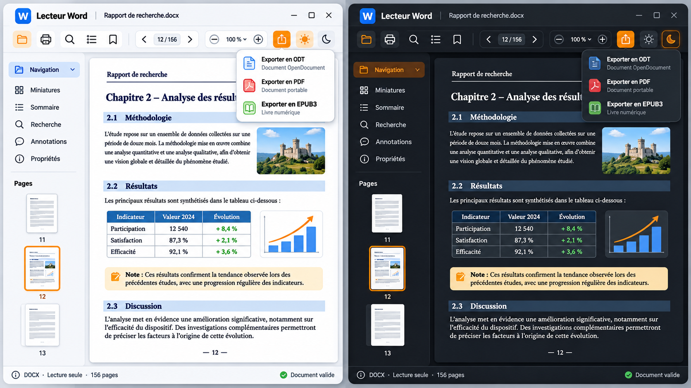

<div align="center">

# Lecteur Word

**Vos documents Word. Une interface claire. Vos originaux préservés.**

Linux · C# / .NET 10 · Avalonia · Lecture seule

**Prototype expérimental — couverture documentaire limitée**

</div>

Lecteur Word construit une visionneuse DOCX native pour Linux : une zone de lecture dominante, des commandes par icônes, des thèmes clair/sombre/système et des diagnostics accessibles. Son moteur OOXML indépendant prépare également un contrat d'échange pour un futur import dans OpusNova.

**Le prototype propose une lecture simplifiée des DOCX structurés et une composition expérimentale d’un profil défini de paragraphes, listes, tableaux et images PNG/JPEG baseline. La fidélité et la pagination de Microsoft Word ne sont pas qualifiées.** Les structures hors couverture restent repérées ; un contenu consultable ne devient pas un export annoncé comme fidèle.

## Une direction visuelle, clairement annoncée



*Maquette approuvée le 20 novembre 2026 : objectif UX du produit, et non capture de l'application, preuve de rendu Word ou démonstration d'exports complets. Le prototype conserve un papier blanc dans le thème sombre.*

La référence est conservée sans conversion, en **1672 × 941 pixels**. Son [empreinte et sa provenance](docs/maquettes/README.md) permettent d'en vérifier l'intégrité.

## Ce qui est disponible

| Composant | État réel du prototype |
|---|---|
| **Inspection DOCX** | Contrôles ZIP/OPC/XML, inventaire structuré avec provenance, diagnostics, manifeste JSON v1 et SHA-256 des médias. |
| **Lecture** | Un DOCX dont les pages sont qualifiées ouvre en Page simple, avec Double page accessible dès l’ouverture. Le moteur couvre un profil expérimental de paragraphes latins, listes, tabulations, tableaux et images. Hors profil, le lecteur affiche un diagnostic et propose la lecture continue sur choix explicite si le contenu est lisible. L’import DOC binaire est prévu pour la V2. |
| **Polices du document** | Familles Linux réellement chargées, thèmes latins, héritage et substitutions tracées ; fontes TTF incorporées dans un périmètre vérifié. Détails dans [la matrice typographique](docs/polices-et-typographie.md). |
| **Interface Avalonia** | Clair/sombre/système, FR/EN, sommaire et signets dans le flux simplifié, recherche, diagnostics regroupés avec rapport détaillé. Pages/miniatures et zoom pour le profil composé. Aucun menu classique. |
| **Version / À propos** | Version sémantique, heure UTC et locale, commit réel et état local détectables au build, cible et runtime ; informations embarquées et copiables sans Git à l’exécution. Crédits et notices tierces, licence du projet à définir. |
| **Protection des sources** | Ouverture en lecture seule, budgets de ressources, annulation, aucune macro/OLE exécutée ni ressource externe chargée. |
| **PDF** | Export limité au profil simple latin, issu de la composition interne, avec police embarquée. Contrôles par des lecteurs PDF indépendants sur fixtures synthétiques. |
| **ODT** | Export de paragraphes simples en ODF 1.3 éditable ; schémas et réouverture de référence vérifiés sur le profil testé. |
| **EPUB3** | Export simple reflowable ; structure et conservation du texte testées, validation EPUBCheck avec les règles EPUB 3.3. |
| **Contrat OpusNova** | Protocole local versionné et sonde Rust de recette. L'import `.nova` reste non implémenté et `importReady` reste `false`. |

Les exporteurs restent soumis au précontrôle du profil simple, sans extension liée à la lecture simplifiée. Les propriétés essentielles non mappées bloquent l'export. Le compteur correspond uniquement aux **pages calculées du profil composé**. Le mode simplifié affiche « Sans pages ».

La [pagination expérimentale](docs/pagination-experimentale.md) conserve le texte et ses provenances. Polices demandées utilisées lorsqu’elles sont disponibles et exploitables, substitutions explicites, alignements, interlignes, paragraphes solidaires et veuves/orphelines sont qualifiés sur un périmètre limité. Miniatures et ajustement à la largeur utilisent les pages réellement calculées. Le PDF simple garde sa pagination antérieure, distincte du nouvel aperçu ; aucun export complexe n’est ajouté.

Les numéros des notes sont des repères de lecture, attribués après vérification de la correspondance entre appel et contenu. Ils ne prétendent pas reproduire les redémarrages ou formats Word. En l’absence de valeur enregistrée d’un champ, aucune valeur n’est fabriquée. Le texte original, les instructions et les provenances restent dans l’inventaire et les diagnostics détaillés.

La note s’ouvre dans un espace réservé à droite ou en bas selon la largeur disponible. Fermeture, Échap et retour à l’appel sont accessibles au clavier. Les diagnostics commencent par une synthèse utilisateur ; les informations XML restent accessibles à la demande.

## Limites actuelles et suite prévue

La [composition étendue](docs/composition-listes-tableaux-images.md) conserve tableaux à grille, fusions compatibles, lignes entières et en-têtes répétés. [LAYOUT-001C](docs/compatibilite-pagination.md) ajoute justification simple, espacement contextuel, marques de paragraphe, liens textuels, AutoFit mesuré, styles généraux de tableaux et JPEG baseline intégrés avec orientation EXIF contrôlée. AutoFit complexe, styles conditionnels, tableaux imbriqués, partage interne des lignes, habillage des flotteurs, colonnes multiples, placement des notes et recalcul des champs restent non qualifiés. Les corps de commentaires et objets spécialisés restent inventoriés ; les éléments non représentés portent des repères. Les listes et styles sont partiellement interprétés ; substitution de polices possible. Les PNG à palette, JPEG progressifs/CMYK et autres formats hors profil ne sont pas décodés.

Restent à qualifier ou implémenter : navigation précise à l’intérieur des tableaux longs, impression, comparaison visuelle Word, lecteur d’écran et DPI physiques multiples, associations de fichiers et Native AOT. Aucune conformité Word, PDF/A ou PDF/UA n'est annoncée.

Le dossier local **`exemples/` est entièrement exclu de Git**, sous-dossiers compris. Il peut recevoir vos documents de travail. Le lecteur ouvre les DOCX en lecture seule ; la modification du texte nécessite un éditeur externe.

La [matrice de couverture](docs/architecture-et-couverture.md) distingue lecture, inventaire, représentation, refus et éléments non testés. Le [contrat UX](docs/ux.md) sépare les contrôles disponibles de leur recette physique.

## Ouvrir depuis le bureau Linux

Le lanceur **Lecteur Word** utilise l’icône fournie et ouvre la version installée pour votre utilisateur. Le raccourci du bureau et l’entrée Applications gardent un chemin stable lors des mises à jour. Voir [l’installation Linux](docs/installation-linux.md).

## Construire et ouvrir l'application

Prérequis : Linux x64, bibliothèques système habituelles d'Avalonia/Skia et SDK **.NET 10.0.404**. Le runtime ciblé est **10.0.15** ; les versions NuGet sont épinglées et leurs lockfiles sont inclus. Aucun Microsoft Office, LibreOffice ou ONLYOFFICE n'est nécessaire à l'exécution.

Depuis la racine du projet, avec les chemins contenant des espaces entre guillemets :

```sh
# Optionnel : installer le SDK épinglé dans .local/dotnet, après vérification SHA-512
python3 tools/bootstrap-dotnet.py

.local/dotnet/dotnet restore LecteurWord.slnx --packages .local/packages --locked-mode
.local/dotnet/dotnet build src/LecteurWord/LecteurWord.csproj --no-restore -c Release -m:1
.local/dotnet/dotnet run --project src/LecteurWord/LecteurWord.csproj --no-build -c Release
```

Pour ouvrir directement un document local, ajouter `-- "/chemin/document.docx"` à la commande `run`. Si le SDK épinglé est déjà installé, `dotnet` peut remplacer `.local/dotnet/dotnet`.

Une publication autonome locale embarque le runtime .NET ; les dépendances système Linux restent nécessaires :

```sh
.local/dotnet/dotnet publish src/LecteurWord/LecteurWord.csproj -c Release \
  -r linux-x64 --self-contained true -p:PublishTrimmed=false \
  --packages .local/packages -o .local/publish-viewer -m:1

.local/publish-viewer/LecteurWord
```

Aucune association de fichiers ni application par défaut n'est installée ou remplacée automatiquement.

## Inspecter sans interface graphique

Le helper utilise le même cœur OOXML, sans dépendance fonctionnelle au viewer :

```sh
.local/dotnet/dotnet build src/DocxCore.Cli/DocxCore.Cli.csproj --no-restore -c Release -m:1
.local/dotnet/dotnet src/DocxCore.Cli/bin/Release/net10.0/docx-core.dll capabilities

mkdir -p /tmp/lecteur-word-inspection
.local/dotnet/dotnet src/DocxCore.Cli/bin/Release/net10.0/docx-core.dll inspect \
  --input "/chemin/document.docx" \
  --output /tmp/lecteur-word-inspection/resultat-neuf
```

Le dossier final doit être neuf. Le code de sortie **2** signifie « inventaire achevé, qualification sémantique partielle » ; il n'autorise pas un import dans OpusNova et ne signifie pas « document valide ». Les [codes, budgets et données d'échange](docs/contrat-opusnova-v1.md) sont documentés.

## Qualification ciblée

Les cas reproductibles utilisent des fixtures synthétiques. Les cas réels nécessitent explicitement le chemin d’une copie consentie dans `LECTEUR_WORD_QA_INPUT`. DOCX générés, documents personnels, rapports, captures et résultats restent locaux et exclus de Git.

```sh
.local/dotnet/dotnet build tests/DocxCore.Targeted/DocxCore.Targeted.csproj --no-restore -c Release -m:1
python3 tools/check-target.py --case unicode

.local/dotnet/dotnet build tests/Viewer.Targeted/Viewer.Targeted.csproj --no-restore -c Release -m:1
python3 tools/check-target.py --component viewer --case gui
python3 tools/check-target.py --component viewer --case gui-search-unicode
python3 tools/check-target.py --component viewer --case reading-model
python3 tools/check-target.py --component viewer --case about-metadata
python3 tools/check-target.py --component viewer --case about-gui
```

Chaque commande sélectionne un cas explicite. **Aucune suite complète sans autorisation distincte.** Les outils de recette Office/PDF/EPUB éventuels sont séparés du runtime ; LibreOffice ne sert qu'à réouvrir des exports synthétiques dans un profil QA temporaire.

## Architecture et documentation

| Projet | Rôle |
|---|---|
| `src/DocxCore` | Inspection bornée et contrat structuré indépendant de toute GUI. |
| `src/DocxCore.Cli` | Helper local hors processus pour l'inspection. |
| `src/DocxFlow` | Projection limitée, composition expérimentale et exporteurs. |
| `src/LecteurWord` | Visionneuse Avalonia en lecture seule. |
| `tests` | Cas ciblés synthétiques et sonde de contrat Rust. |

- [Architecture et couverture](docs/architecture-et-couverture.md)
- [Récupération, support GitHub et extensions](docs/plateforme.md)
- [Contrat OpusNova v1](docs/contrat-opusnova-v1.md) et [schéma JSON](docs/manifest-v1.schema.json)
- [Sécurité et limites](docs/securite.md)
- [UX et qualification](docs/ux.md)
- [Dépendances et licences](docs/dependances.md)
- [Stratégie DOCX indépendante et retrait du moteur externe](docs/strategie-rendu-docx-independant.md)
- [Provenance des fichiers de test et de la maquette](docs/provenance.md)

## Licence et diffusion

**La licence du nouveau code reste à confirmer par le propriétaire avant diffusion.** Les notices des dépendances et de la police DejaVu sont conservées séparément ; aucune licence n'est choisie implicitement pour le projet. Le code et la licence GPL-3.0-only d'OpusNova ne sont pas modifiés.

Le raccordement au dépôt privé prépare la revue du premier commit. Il n'autorise ni commit, ni push, ni publication de données personnelles, de corpus, de binaires générés ou de résultats de tests.
