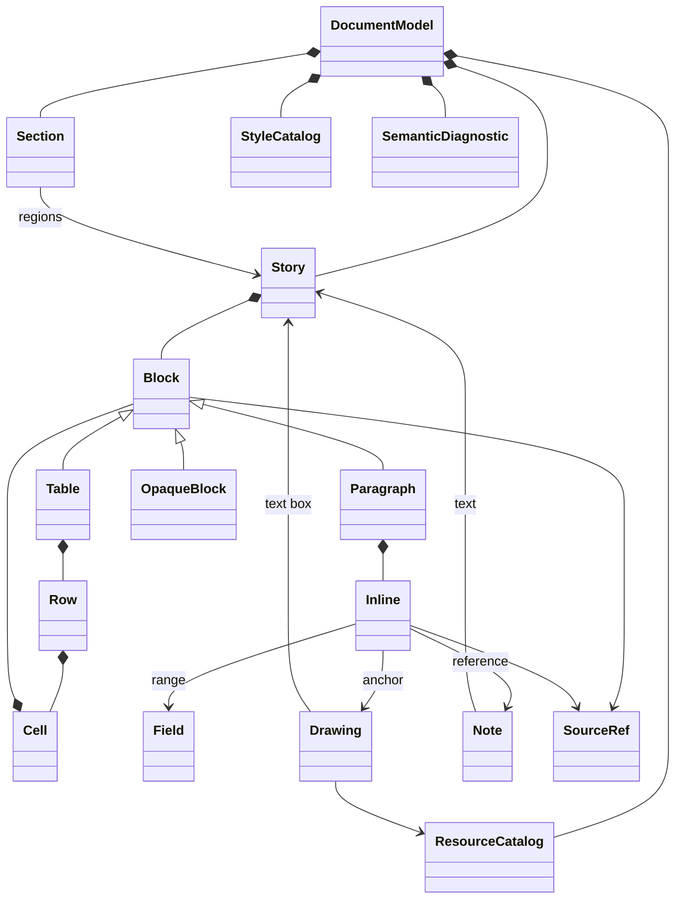

# Modèle documentaire

Le modèle sémantique est une projection typée, indexée au-dessus du snapshot DocxCore. Il garde une référence vers l’inventaire d’origine et partage les chaînes, styles et ressources. Il ne crée ni archive DOCX intermédiaire ni second DOM indépendant. Les types ci-dessous appartiennent à DocxFlow. Le manifeste v1 et les usages de DocxCore.Cli restent distincts.

| Donnée | Représentation et règles |
|---|---|
| Identité documentaire | SHA-256 du snapshot accepté. Les identifiants de parties et de nœuds restent relatifs à ce snapshot. Aucun identifiant garanti stable après réécriture externe du DOCX |
| Source | `SourceRef(SnapshotId, PartUri, XmlPath, NodeId, TextSpan?)`. Étendue UTF-16 demi-ouverte dans la valeur XML décodée, bornée et alignée aux scalaires. Les éléments composés peuvent référencer plusieurs sources ordonnées. Les contrôles non textuels gardent une source sans étendue |
| Histoires | Corps principal, variantes d’en-tête/pied, corps et séparateurs de notes, zones de texte et commentaires avec leur ordre propre. Un paragraphe vide garde sa marque et ses propriétés. Les liens entre histoires portent un identifiant de relation et ne dupliquent pas leur contenu |
| Blocs et caractères | Paragraphes, tables, blocs opaques et ruptures explicites. Séquences typées de texte exact, espace significatif, tab, saut de ligne/page/colonne, tiret souple, symbole, ancre d’objet, appel de note, limites/résultats de champ. Les propriétés de la marque restent distinctes du run |
| Styles et listes | Définitions, valeurs par défaut, héritage, liens style/numérotation, niveaux et redémarrages. Résolution selon les règles propres à chaque propriété, incluant commutateurs, thème, exceptions et fermeture d’un cycle. Conserver valeur déclarée, effective, origine de la règle et statut de couverture |
| Sections | Limite explicite portée par le paragraphe de clôture ou la fin du corps, réglages de page et colonnes, type de transition, sens et numérotation. Chaque variante d’en-tête/pied indique partie, sélection, héritage et absence éventuelle |
| Tables | Grille logique, largeurs préférées et unités d’origine, styles, rangée, cellule et propriétaire de fusion. Fusions représentées par origine et membres. Blocs de cellule récursifs avec quota. Propriétés de séparation, cantSplit et répétition conservées |
| Notes | Clé composée de la partie et de l’ID OOXML, type, statut de service, numéro de présentation, règle de redémarrage, appels ordonnés et histoire. Résoudre exclusivement via les relations de la partie appelante. IDs ambigus et corps orphelins sont distincts |
| Champs | Arbre de champs simples/complexes par histoire, listes de spans d’instruction et de résultat, type, arguments analysés, dirty/locked, référence de signet. Valeur enregistrée et résultat éventuellement calculé restent séparés et datables |
| Dessins | Inline ou ancré, repère de position, dimensions EMU, marges d’habillage, polygone, ordre de peinture, rognage et transformation. Forme ou groupe, aperçu, image, texte de description et vraie histoire de zone de texte distincts. Pas de conversion d’un offset ou de métadonnées en texte visible |
| Contenus alternatifs | Conserver chaque branche MC et ses déclarations de namespace. Sélectionner dans l’ordre le premier Choice dont les exigences sont prises en charge par le profil, sinon Fallback admissible. Consigner le choix, le motif et les branches inactives. MustUnderstand non résolu et absence de branche utilisable ont un impact déclaré. Autoriser une projection passive altChunk uniquement pour un format local borné explicitement qualifié |
| Révisions, commentaires et contrôles | Étendues typées et parfois chevauchantes, auteur/date en données privées, valeurs avant/après, suppressions/déplacements et propriétés. La projection finale, originale ou annotée est un paramètre de génération. Préserver les identifiants de commentaires et les contenus de contrôles. Aucune mise à jour des données liées à distance |
| Objets spécialisés | Équation, graphique, diagramme, VML, OLE, contrôle ou extension inconnue. Identité, métadonnées, relations, emplacement, aperçu déclaré et raison d’inertie. La composition peut exploiter un aperçu déjà présent et validé avec un repère si le contenu essentiel est indisponible |
| Ressources | Index d’identifiants et hashes du snapshot. Relation interne acceptée et type réel validé avant interprétation. Tout décodage dérivé garde un identifiant, un format et un hash distincts. Les binaires et chemins hôte ne font pas partie des positions de pages |

## Résolution et couverture

Le constructeur parcourt par QName développé et groupe les entités par histoire. Il valide les clés et portées avant d’établir une association. Il crée des index immuables sur les parents, plages, signets et ressources une fois le snapshot accepté. Un graphe de dépendances rattache chaque propriété effective ou objet à ses sources. Les modifications de profil reconstruisent uniquement les projections concernées. Les structures de base existantes sont alimentées par des adaptateurs au fil des lots, avec comparaison des identifiants, résultats et diagnostics.

Chaque nœud, propriété ou intervalle de texte susceptible d'affecter la présentation reçoit un statut explicite. La politique de projection distingue contenu actif choisi, contenu écarté par règle documentée, métadonnées inertes, contenu affiché ou reporté en consultation, et contenu incompris. Une propriété inconnue reçoit un impact indéterminé jusqu’à preuve. Toute projection qui regroupe plusieurs nœuds, répète un titre ou génère un libellé garde le lien à ses causes. L’inventaire brut reste consultable et ne dépend pas du verdict de pagination.
