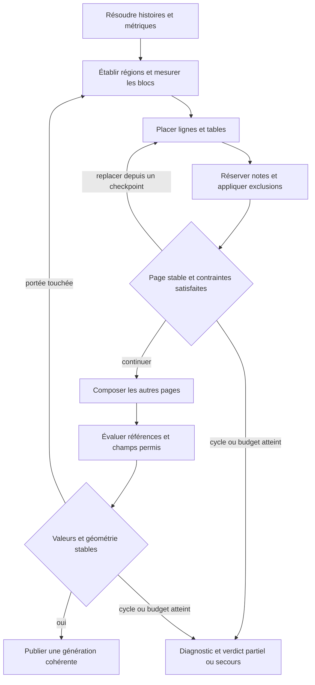

# Composition des pages

L’algorithme étend le compositeur DocxFlow actuel. Il consomme le modèle sémantique, les faces figées et un profil de compatibilité explicite. Les formules et priorités dépendantes de Word sont versionnées et accompagnées d’un témoin. Deux exécutions avec mêmes données, versions, options et faces doivent produire la même géométrie indépendamment du DPI de la vue.

## Placement par régions

- Définir le rectangle physique, les marges, la reliure et les variantes recto/verso, puis les régions de corps, colonnes, en-tête, pied et notes. Distinguer index physique et numéro imprimé. Résoudre la variante de début et les changements de section au bon point. Une section continue partage la page si les contraintes de régions sont satisfaites. Traiter les transitions incompatibles et les pages intercalaires selon les règles du profil.
- Mesurer les blocs sans allouer d’image pleine page. Construire les lignes à partir de clusters et boîtes inline. Calculer les taquets centrés/droits/décimaux avec la longueur du segment à venir et dessiner les points de suite comme éléments générés. Respecter retours forcés, paragraphes solidaires, veuves/orphelines et bordures. Quand un groupe indivisible dépasse une région vide, appliquer une règle documentée de découpe ou de refus. Aucun avancement forcé par boucle sans progrès.
- Mesurer les tables avec minima et préférences par colonne, contraintes par cellule fusionnée, résolution des styles et traits partagés. Conserver largeur disponible et cause de chaque contrainte. La hauteur à l’issue du retour à la ligne alimente les rangées, y compris cellules fusionnées, marges et objets. Les séparations doivent respecter cantSplit, répétitions d’en-tête et continuations. Une répétition réutilise la source avec une occurrence visuelle propre. Budget explicite pour récursion, cellules et mesures.
- Positionner dessins et boîtes par référence à la page, marge, colonne, paragraphe ou caractère. Calculer séparément rectangle d’encre, zone d’exclusion de flux et clip. Appliquer matrices locales→page aux images et zones de texte, puis empilement et clipping. Respecter réserves d’habillage, layoutInCell, chevauchement et conservation de l’ancre avec son paragraphe. En cas de collision, recalculer seulement la région affectée à partir d’un checkpoint antérieur. Un flottant n’est jamais transformé implicitement en dessin inline. Les politiques carré, serré, au travers et haut/bas ont chacune un profil et un test.
- Pendant le placement des lignes, faire remonter les appels de note déposés sur la page. Mesurer les notes ancrées aux appels, réserver leur zone et replacer les dernières lignes lorsque la région rétrécit. Si un appel change de page, déplacer sa réservation aussi. Définir ensuite séparateur, prolongement, scission et règles de report. Réinsérer les notes de fin au point de fin de section/document selon la configuration, avec règles de suppression/report explicites. L’ordre des corps ne se déduit jamais de l’ordre de leurs ID.

## Stabilisation et dépendances

Les champs liés à la pagination s’évaluent sur un instantané. PAGE suit la numérotation de section, PAGEREF résout le signet et NUMPAGES/SECTIONPAGES consultent le bilan final. Un champ verrouillé garde sa valeur enregistrée. Un champ inconnu, externe ou non convergé conserve son code et sa valeur enregistrée si disponible et admissible, avec statut visible. Pas d’interprète de macros, de requêtes ou de liens. Le TOC réutilise d’abord les entrées enregistrées avec leurs tabulations. Son recalcul limité est un lot dépendant des champs, des styles et des signets. La valeur générée demeure une vue de la génération.

Établir un checkpoint sur une limite de page ou section dont les dépendances sont connues. Il mémorise curseurs des histoires, suite des objets, compteurs, contenu de région, notes en continuation, champs impactés et empreintes du profil. Les signatures de convergence couvrent au moins coupures et numéros de pages, placements/tailles des objets, notes, signets et texte des champs. Arrêt sur signature stable après réévaluation complète ou sur cycle détecté. Les quotas initiaux proposés de **8 reprises locales par page** et **4 passes globales** s’appliquent sous le budget temporel, à ajuster sur mesures. Toute reprise doit faire progresser le curseur, changer une signature ou terminer avec un diagnostic. Aucun résultat oscillant ne devient final.

Une règle inconnue qui peut changer le flux ou sa topologie bloque la publication comme pages fiables sur la zone dépendante. Si son effet a une enveloppe démontrée et que le texte essentiel reste accessible, la zone peut être publiée comme partielle avec repère. Lorsque l’impact est inconnu jusqu’en fin de document, le repli peut concerner tout le document. Préserver l’inventaire et ne jamais enlever un garde-fou pour franchir un compteur de pages de corpus.
