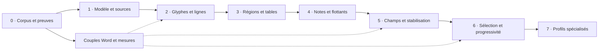

# Découpage, critères de sortie et risques

La migration part des cas indépendants validés et conserve les entrées publiques actuelles pendant l’évolution. Un lot s’arrête sur une preuve ciblée, un bilan du corpus contrôlé, des voisins et un build. Chaque changement de profil doit expliquer par quelle règle une page apparaît, disparaît ou change. La validation du profil et la conformité Word sont reportées séparément.

| Lot | Dépend de | Livrable et entrée de migration | Critère de sortie |
|---|---|---|---|
| 0 · Preuves | ARCH-001 | Figer les mesures C# et obtenir les couples Word représentatifs par SHA. Préparer les témoins et la version de référence des politiques | Reprise du profil C# de référence, métriques reproductibles, couples séparés par niveau de preuve |
| 1 · Modèle et couverture | 0 pour baseline C# | Projection sémantique par histoires et registre. Adapter `ReadableReader` et `LayoutReader` trait par trait, commencer par paragraphes et sources. Établir le contrat des unités et identités | Pas de perte à la traversée, conservation des branches et inconnus, mêmes résultats v1, lecture simplifiée et export. Les hosts natifs restent hors du modèle |
| 2 · Typographie et lignes | 1, revue des binaires | Un point d’entrée de composition avec mesure des mêmes glyphes que le peintre. D’abord profil latin, puis cluster/bidi et autres écritures sous garde. Brancher tabulations et positions de fragments | Témoins de texte courant et de scripts latins conformes au profil retenu, invariants grapheme/source, exacte conservation du texte et des ignorable/PUA. Comparaisons Word dès disponibilité |
| 3 · Régions et tables | 2 | Séparer régions du corps et ajout des variantes d’en-tête/pied, transitions et numérotation. Étendre calcul des tables à styles conditionnels, largeurs et scissions validées | Propriétés de sections, largeurs/hauteurs et fusions mesurées. Répétitions traçables. Écarts expliqués sur des témoins de tableaux. Aucun recul synthétique LAYOUT-001C |
| 4 · Notes, ancres, dessins | 3 | Deux sous-lots. Réservations/report des notes d’abord, ancrage et habillage ensuite. Intégrer la politique MC et les objets à aperçu passif | Notes traçables sur pages et retour cohérent. Les témoins vérifient le rognage, l’ordre, l’alignement et le diagnostic du contenu inerte. Reprises locales bornées |
| 5 · Champs et stabilisation | 4 | Valeurs enregistrées d’abord, puis PAGE/NUMPAGES/SECTIONPAGES/PAGEREF et TOC selon profil. Graphe de dépendances et arrêt des reprises | Test des cycles et garde d’itération, génération cohérente. Sommaire et sections avec notes évalués avec le couple Word quand fourni. Toute divergence est rapportée |
| 6 · Interaction et performance | 2 pour peinture et sélection de base. 5 pour publication progressive | Recherche et positions communes, quads de sélection, cache viewport et publication par générations | Recherche et sélection UTF-16 réversibles, transformations qualifiées, aucune opération périmée, mesures médiane/p95 et mémoire réconciliées. Avalonia conservée |
| 7 · Profils spécialisés | 1–6 selon fonction | Équations, graphiques, VML étendu, révisions avancées et autres profils ciblés après analyse du corpus et des usages | Témoins et règles par format, sécurité et licences des nouveaux décodeurs, décision explicite de couverture. Un favorable résultat DOCX ne requalifie pas les exports |

Produire pour chaque lot une table `existant → changement → preuve`, des fixtures synthétiques d’origine documentée, les refus associés, les mesures de performance et la liste de fichiers concernés. Le cas `independent-corpus` sert de garde tant que ses attentes décrivent le profil hérité. Lors d’un élargissement, établir une nouvelle matrice attendue expliquée par document et conserver la précédente comme référence. L’obtention de PDF conditionne le label de fidélité, sans bloquer la construction et les tests des invariants indépendants.

## Risques et décisions

| Risque | Décision | Déclencheur d’arbitrage |
|---|---|---|
| Divergences de Word liées aux fontes/options | Profils explicites, référence reproductible, provenance par glyphes | Si deux références divergent, reproduire leurs paramètres avant de modifier un algorithme |
| Extension trop large du modèle | Introduire les types par tranche. Garder l’inventaire et les interfaces stables | Si une abstraction impose une seconde copie du document ou un moteur alternatif permanent, revoir les projections |
| Boucles notes/flottants/champs | Reprises bornées avec signatures et arrêts, checkpoints | Si oscillation ou recalcul global coûteux, conserver le repère ou repli et isoler la cause avant extension |
| Mise en page partielle trompeuse | Verdict du registre de couverture et enveloppe d’impact, source consultable | Si un objet décale des pages non bornables ou que la topologie n’est pas connue, lecture de secours |
| Interaction fausse sur positions transformées | Partager les quads et clips du peintre, tester positions inverses | Si provenance ou mapping non établi, position inconnue, accès textuel maintenu |
| Vulnérabilité dans média/typo natifs | Contrôles préalables, ressources locales et budgets. Confinement dédié pour élargissements risqués | Si ressources ou capacités OS nécessaires manquent, ne pas activer le profil |
| Dépendance ou licence imprévue | Utiliser d’abord les actifs existants. Inspecter actifs et notices par RID | Bloquer l’intégration de ce composant tant que son origine/droits et son coût restent inconnus |
| Duplication d’algorithmes pendant migration | Adapter les profils existants, choisir une seule source de vérité après qualification | Si la transition dépasse un lot, fixer le chemin propriétaire par profil et supprimer le double calcul dès validation |
| Surcoût de cycles de vie et cache | Raster à la demande d’abord, métriques par phase, éviction par budget | Si dépassement p95, croissance mémoire ou régression du petit document, optimiser et requalifier avant d’élargir |

Le premier lot de code recommandé après autorisation est la projection du modèle et des sources pour paragraphes, runs et régions, avec adaptation du chemin existant. Son périmètre se limite à un contrat testable et aux acquis. La composition des notes, des flottants et du sommaire dépend de ce socle. Les bibliothèques techniques seront examinées sur les versions et binaires réellement envisagés.
