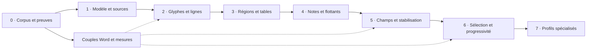

# Découpage, critères de sortie et risques

La migration part des cas indépendants validés et conserve les entrées publiques actuelles pendant l’évolution. Un lot s’arrête sur une preuve ciblée, un bilan des onze copies, des voisins et un build. Chaque changement de profil doit expliquer par quelle règle une page apparaît, disparaît ou change. La validation du profil et la conformité Word sont reportées séparément.

| Lot | Dépend de | Livrable et entrée de migration | Critère de sortie |
|---|---|---|---|
| 0 · Preuves | ARCH-001 | Figer les mesures C# et obtenir les couples Word représentatifs par SHA. Préparer les témoins et la version de référence des politiques | Reprise des résultats C# 11/11 dont 1 paginé, métriques reproductibles, couples séparés par niveau de preuve |
| 1 · Modèle et couverture | 0 pour baseline C# | Projection sémantique par histoires et registre. Adapter `ReadableReader` et `LayoutReader` trait par trait, commencer par paragraphes et sources. Établir le contrat des unités et identités | Pas de perte à la traversée, conservation des branches et inconnus, mêmes résultats v1, lecture simplifiée et export. Les hosts natifs restent hors du modèle |
| 2 · Typographie et lignes | 1, revue des binaires | Un point d’entrée de composition avec mesure des mêmes glyphes que le peintre. D’abord profil latin, puis cluster/bidi et autres écritures sous garde. Brancher tabulations et positions de fragments | Lettre et fixtures latines conformes au profil retenu, invariants grapheme/source, exacte conservation du texte et des ignorable/PUA. Comparaisons Word dès disponibilité |
| 3 · Régions et tables | 2 | Séparer régions du corps et ajout des variantes d’en-tête/pied, transitions et numérotation. Étendre calcul des tables à styles conditionnels, largeurs et scissions validées | Propriétés de sections, largeurs/hauteurs et fusions mesurées. Répétitions traçables. Cas guide et bilan avec écarts expliqués. Aucun recul synthétique LAYOUT-001C |
| 4 · Notes, ancres, dessins | 3 | Deux sous-lots. Réservations/report des notes d’abord, ancrage et habillage ensuite. Intégrer la politique MC et les objets à aperçu passif | Notes 02/03/10 traçables sur pages et retour cohérent. 00/05/08/09 permettent de démontrer clip, ordre, alignement et diagnostic de contenu inerte. Reprises locales bornées |
| 5 · Champs et stabilisation | 4 | Valeurs enregistrées d’abord, puis PAGE/NUMPAGES/SECTIONPAGES/PAGEREF et TOC selon profil. Graphe de dépendances et arrêt des reprises | Test des cycles et garde d’itération, génération cohérente. Sommaire Stage 2 et sections/notes évalués avec le couple Word quand fourni. Toute divergence est rapportée |
| 6 · Interaction et performance | 2 pour peinture et sélection de base. 5 pour publication progressive | Recherche et positions communes, quads de sélection, cache viewport et publication par générations | Recherche et sélection UTF-16 réversibles, transformations qualifiées, aucune opération périmée, mesures médiane/p95 et mémoire réconciliées. Avalonia conservée |
| 7 · Profils spécialisés | 1–6 selon fonction | Équations, graphiques, VML étendu, révisions avancées et autres profils ciblés après analyse du corpus et des usages | Témoins et règles par format, sécurité et licences des nouveaux décodeurs, décision explicite de couverture. Un favorable résultat DOCX ne requalifie pas les exports |

Produire pour chaque lot une table `existant → changement → preuve`, des fixtures synthétiques d’origine documentée, les refus associés, les mesures de performance et la liste de fichiers concernés. Le cas `independent-corpus` sert de garde tant que ses attentes décrivent le profil hérité. Lors d’un élargissement, établir une nouvelle matrice attendue expliquée par document et conserver la précédente comme référence. L’obtention de PDF conditionne le label de fidélité, sans bloquer la construction et les tests des invariants indépendants.

## Risques et décisions

| Risque | Décision | Déclencheur d’arbitrage |
|---|---|---|
| Divergences de Word liées aux fontes/options | Profils explicites, référence reproductible, provenance par glyphes | Si deux références divergent, reproduire leurs paramètres avant de modifier un algorithme |
| Extension trop large du modèle | Introduire les types par tranche. Garder l’inventaire et les interfaces stables | Si une abstraction impose une seconde copie du document ou un moteur alternatif permanent, revoir les projections |
| Boucles notes/flottants/champs | Reprises bornées avec signatures et arrêts, checkpoints | Si oscillation ou recalcul global coûteux, conserver le repère ou repli et isoler la cause avant extension |
| Mise en page partielle trompeuse | Verdict du registre de couverture et enveloppe d’impact, source consultable | Si un objet décale des pages non bornables ou que la topologie n’est pas connue, lecture de secours |
| Interaction fausse sur positions transformées | Partager les quads et clips du peintre, tester positions inverses | Si provenance ou mapping non établi, position inconnue, accès textuel maintenu |
| Vulnérabilité dans média/typo natifs | Contrôles préalables, ressources locales et budgets. Confinement dédié pour élargissements risqués | Si ressources ou capacités OS nécessaires manquent, ne pas activer le profil |
| Dépendance ou licence imprévue | Utiliser d’abord les actifs existants. Inspecter actifs et notices par RID | Bloquer l’intégration de ce composant tant que son origine/droits et son coût restent inconnus |
| Duplication d’algorithmes pendant migration | Adapter les profils existants, choisir une seule source de vérité après qualification | Si la transition dépasse un lot, fixer le chemin propriétaire par profil et supprimer le double calcul dès validation |
| Surcoût de cycles de vie et cache | Raster à la demande d’abord, métriques par phase, éviction par budget | Si dépassement p95, croissance mémoire ou régression du petit document, optimiser et requalifier avant d’élargir |

Le premier lot de code recommandé après autorisation est la projection du modèle et des sources pour paragraphes, runs et régions, avec adaptation du chemin existant. Son périmètre se limite à un contrat testable et aux acquis. La composition des notes, des flottants et du sommaire dépend de ce socle. Les bibliothèques techniques seront examinées sur les versions et binaires réellement envisagés.

## Histoires auxiliaires et SmartArt calculés

Les ancres d’en-tête et de pied utilisent les référentiels de la section et les côtés de la feuille. Le modèle conserve les positions absolues ou en pourcentage, les dimensions relatives, les distances d’habillage, l’ordre de l’ancre et celui de ses enfants. Les groupes rectangulaires WPG et VML imbriqués appliquent les origines et étendues de chaque repère enfant. Les zones de texte conservent leurs retraits et leur alignement vertical. Les dessins alternatifs sont vérifiés par rapprochement des géométries, de la peinture et des arbres de texte du repli VML. Le peintre utilise la géométrie DrawingML une fois. Un groupe VML autonome du même profil conserve sa propre provenance. [Extensions DrawingML](https://learn.microsoft.com/en-us/openspecs/office_standards/ms-odrawxml/1a38a99a-16ae-420d-8c79-23dc2e922717)

L’habillage haut et bas ou carré sur toute la largeur peut réserver une bande attenante au corps. Un habillage latéral qui demanderait de recomposer le texte du corps le long d’une forme est diagnostiqué. Une histoire composée uniquement d’ancres indépendantes peut occuper une marge plus courte que la distance déclarée du pied. Les formes restent à leurs coordonnées et leur peinture est découpée par la feuille. Le résultat d’un champ calculé reste dans la composition avec sa source, même entièrement hors papier. Les champs PAGE, NUMPAGES et SECTIONPAGES réutilisent les formats et métriques du moteur. Les rotations libres des groupes auxiliaires, chemins complexes hors profils vectoriels existants, effets non résolus et zones demandant réajustement ou débordement du texte dans le corps restent hors profil.

Un dessin SmartArt enregistré et exploitable reste prioritaire. En l’absence de dessin enregistré, le moteur valide un graphe acyclique de liens de parenté ordonnés, puis développe le plan avant de façonner les libellés et de peindre les objets. Les plans acceptés utilisent les variantes ci-dessous. [Plans de disposition SmartArt](https://learn.microsoft.com/en-us/archive/msdn-magazine/2007/february/create-custom-smartart-graphics-for-use-in-the-2007-office-system) · [Paramètres d’algorithmes](https://learn.microsoft.com/en-us/openspecs/office_standards/ms-oi29500/3c6745b9-8475-4960-91ba-a9a16ec7df86)

| Famille | Variantes composées |
|---|---|
| Liste | `lin`, quatre sens, cases fixes disposées dans une rangée ou colonne, ordre issu des liens, écart uniforme lorsqu’il est disponible |
| Processus | `lin` ou `snake`, rangées ou colonnes, départ par un des quatre coins, reprise dans le même sens ou en sens inverse, capacité calculée ou seuil fixe |
| Cycle | `cycle`, centres sur une ellipse, angles initial et total déclarés, libellés horizontaux, sans forme centrale, avec vérification de l’absence de chevauchement des boîtes |
| Hiérarchie | `hierRoot` et `hierChild`, racine unique, niveaux décroissants vers le bas, parent centré sur ses enfants, liens parent-enfant |
| Relation | `composite`, positions et dimensions explicites, association des connecteurs aux noms de disposition |
| Matrice | `composite`, lignes et colonnes établies par les contraintes des cellules, choix possible du plan selon le nombre de points |
| Pyramide | `pyramid`, niveaux d’égale hauteur avec une enveloppe triangulaire, sommet et trapèzes en vecteurs, labels dans chaque étage |

Les itérations `forEach` ciblent les enfants, descendants ou le point courant et peuvent définir départ, pas et nombre. Les branches `choose/if/else` acceptent les comparaisons sur le nombre et la position. Les contraintes `composite` résolvent deux valeurs par axe parmi origine, centre, extrémité et dimension, exprimées en millimètres ou par facteur d’une propriété du parent ou d’un frère déjà résolu. La règle `primFontSz` donne une borne inférieure explicite lorsqu’un libellé doit être réduit. Les plans imbriqués gardent leur région et leur source. `tx` joint le libellé au point courant. `sp` porte une géométrie décorative, éventuellement tournée. `conn` porte un segment, un raccord orthogonal ou une courbe cubique. Les raccords utilisent des points cardinaux sur le contour et les flèches utilisent les tangentes de départ et d’arrivée. Les thèmes fournissent couleurs, épaisseur de trait et police dans le profil de style pris en charge.

Les plans dépendant d’axes de transition, de répétition nommée, de variables, de références non résolues, de règles complexes, de thèmes à effets ou de routage avec évitement d’obstacles restent diagnostiqués. Le profil de texte reprend les libellés en écriture latine avec métriques et polices vérifiées. Les géométries et contraintes inconnues et les caches non interprétables conservent un diagnostic associé à leur source.

La composition commune expose le graphe et les sources du paquet, les sous-régions et les transformations des dessins, les formes et connecteurs vectoriels, les champs générés et les fragments de texte typographiés. Les histoires et plages du modèle sémantique restent associées aux notes, liens, images, choix de polices et diagnostics. Les futurs exporteurs peuvent lire cette composition commune. Chaque format d’échange garde sa propre qualification de conservation.
