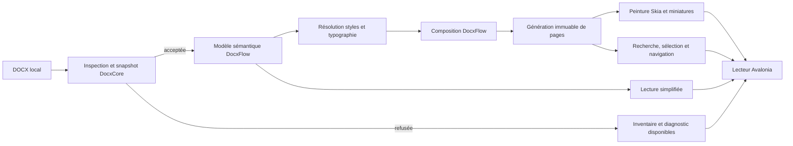

# ARCH-001 · Architecture du moteur DOCX

La composition évolue dans **DocxFlow**, à partir de l’inspection **DocxCore** et derrière l’interface **Avalonia** existante. L’objectif est une fidélité Word mesurable sur des documents et profils de référence identifiés. Les profils de lecture et de pagination du socle sont exercés par des tests ciblés. La fidélité Word reste à qualifier. Ce dossier est une spécification de conception. Ses types et interfaces décrivent une cible.

| Document | Décision ou preuve |
|---|---|
| [Couverture et corpus](01-couverture.md) | Fonctions existantes, améliorations et témoins de maintenance |
| [Modèle documentaire](02-modele.md) | Schéma sémantique commun, identité, espaces de noms et conservation |
| [Typographie et dépendances](03-typographie.md) | Choix des faces, shaping, métriques, licences et choix du périmètre |
| [Composition](04-composition.md) | Contraintes, transitions, convergence, limites et cas de dégradation |
| [Contrats des pages et états](05-contrats.md) | Interfaces, immutabilité, générations, texte, géométrie et règles d’admission |
| [Qualification et performance](06-qualification.md) | Appariement Word, mesures, budgets, sécurité, annulation et stabilité |
| [Travaux, risques et arbitrages](07-travaux.md) | Dépendances entre lots, critères de sortie et premières décisions |

Le manifeste d’inspection v1, les profils d’export et la lecture simplifiée existante restent les références de compatibilité de leurs consommateurs. La migration remplace progressivement les mesures et représentations internes de DocxFlow. Des adaptateurs transitoires servent à comparer la sortie actuelle et la sortie proposée sur un même témoin. Une fois le profil validé, un seul chemin de composition sert ce profil. Les preuves et ressources privées figurent dans le dossier de qualification local. L’abandon du moteur externe et la politique d’implémentation indépendante restent acquis. [Stratégie indépendante](../strategie-rendu-docx-independant.md).

Pour chaque fonction, la décision d’implémentation s’appuie sur l’édition pertinente d’ECMA-376, les écarts d’implémentation documentés par Microsoft et des observations reproductibles. Les audits historiques apportent des cas de test et des limites observées. La provenance du code produit est consignée au moment de chaque lot. [ECMA-376](https://ecma-international.org/publications-and-standards/standards/ecma-376/) · [MS-OE376](https://learn.microsoft.com/en-us/openspecs/office_standards/ms-oe376) · [MS-DOCX](https://learn.microsoft.com/en-us/openspecs/office_standards/ms-docx).
