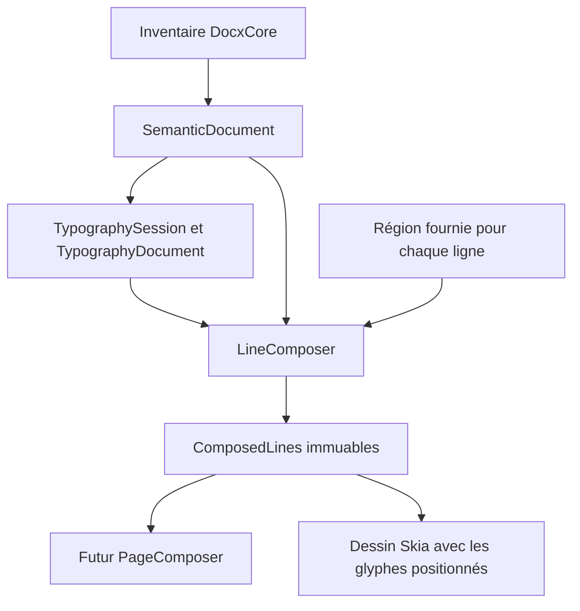

# PAGE-001A — Composition des lignes DOCX

PAGE-001A ajoute une couche interne à DocxFlow. Elle reçoit le modèle sémantique et le résultat de TEXT-001 produits pour le même instantané. Le futur compositeur de pages reçoit des lignes immuables dont il peut exploiter la géométrie et les ancres source. Le choix de pagination d’Avalonia reste celui du moteur C# de lecture actuel.

## Flux



1. Le compositeur lit les propriétés de paragraphe dans l’ordre des valeurs par défaut, du style général de tableau, du style de paragraphe hérité et des propriétés directes. Les déclarations retenues et les taquets gardent leur source. Les options spécialisées encore ouvertes produisent des diagnostics.
2. Les graphèmes, clusters et opportunités Unicode proviennent de TEXT-001. La sélection de coupure exploite les avances HarfBuzz enregistrées. Une largeur qui dépasse après vérification conduit au retrait jusqu’à une opportunité légale. Un groupe indivisible trop large conserve son avance et reçoit un diagnostic de débordement.
3. ICU traite chaque plage de ligne après sa sélection. Les fragments que le bord ou le niveau bidi modifie sont reshappés dans le contexte de la ligne, avec la même face, la même taille, le même script et les mêmes fonctions OpenType. Les niveaux servent à ordonner les clusters visuellement. [Analyse bidi Unicode](https://www.unicode.org/reports/tr9/) · [ICU ubidi_setLine](https://unicode-org.github.io/icu-docs/apidoc/released/icu4c/ubidi_8h.html) · [Coupures Unicode](https://www.unicode.org/reports/tr14/) · [Tampon HarfBuzz](https://harfbuzz.github.io/harfbuzz-hb-buffer.html).
4. Les champs séparés par des tabulations sont positionnés sur les taquets. Le dernier champ peut continuer à la ligne suivante. Le taquet décimal s’aligne sur l’unique séparateur de la langue si le champ est LTR. Un champ sans séparateur est aligné à droite sur le taquet. Les suites et les traits conditionnels dessinés sont signalés à part. [Tabulations Word et héritage](https://learn.microsoft.com/en-us/dotnet/api/documentformat.openxml.wordprocessing.tabs?view=openxml-3.0.1) · [Taquet de retrait suspendu](https://learn.microsoft.com/en-us/dotnet/api/documentformat.openxml.wordprocessing.notabhangindent?view=openxml-3.0.1).
5. La justification simple répartit l’excédent en EMU entre les espaces ordinaires internes des lignes coupées automatiquement. Les espaces terminaux sont conservés dans le texte et dans l’avance logique. Les avances, décalages, glyphes et décorations enregistrés servent directement à fabriquer les runs positionnés Skia.

## Contrat immuable

```csharp
using var typography = new TypographySession(inspected, semantic);
TypographyDocument measured = typography.Measure(cancellation);
using var lines = new LineComposer(semantic, measured, typography);
ComposedLines snapshot = lines.Compose(request => RegionFor(request), cancellation);
```

| Valeur | Interprétation |
|---|---|
| `LineRequest` | Identité du paragraphe et de l’histoire, ordinal local à partir de zéro, position de reprise dans le contexte UTF-16. |
| `LineRegion` | Identité fournie par l’appelant, origine X et largeur de la région en EMU. Les extrémités utiles de ligne tiennent ensuite compte des retraits. |
| `ComposedLine` | Région, identité sémantique, plage logique, type de coupure, propriétés de paragraphe, géométrie, état de couverture et provenance des diagnostics. |
| `LinePart` | Sous-plage logique contiguë. Un fragment garde son texte, son rôle, son style, ses graphèmes, sa face et les plages UTF-16 de ses nœuds. Un contrôle conserve son identifiant d’origine. |
| `LinePlacement` | Index de partie et de cluster, origine du cluster sur la ligne, origine à ajouter aux coordonnées `TextGlyph.X/Y`, avances X/Y, espace de justification ajouté. Un cluster visuel à `-1` représente un contrôle ou un ancrage invisible. |
| `LineTabPlacement` | Source du contrôle, taquet appliqué et limites exactes du blanc occupé. Le champ conserve ses propres sources, y compris `StoredField`. |
| `LineDecoration` | Glyphe généré, cause OOXML ou plage du trait facultatif littéral, position, pas et nombre d’occurrences. Les suites et traits visibles restent distincts du texte source. |
| `Occupied`, `Advance` | Avance occupée après retrait des espaces ordinaires terminaux et après justification, puis avance complète incluant ces espaces. L’encre peut dépasser cette avance. |
| `Ascent`, `Descent`, `Baseline`, `Height` | Extents naturels EMU, positifs sous forme de distances. La ligne de base est relative au haut naturel. Le dessin reçoit la ligne de base dans l’espace de destination. L’interligne OOXML appartient au compositeur de blocs. |

Une provenance contient l’identité d’instantané, l’identité de nœud, l’emplacement OOXML et, pour le texte, la plage UTF-16 locale semi-ouverte. Les offsets du contexte de paragraphe utilisent aussi des plages semi-ouvertes et comptent les contrôles projetés à leur emplacement. Les `Parts` restent logiques pour la copie et la recherche. L’ordre de `Visual` sert au dessin et au déplacement visuel. Les chaînes d’instruction, révisions masquées et branches inactives restent consultables dans `TypographyDocument.Tokens`. La chaîne de copie doit suivre la politique de projection de cette génération.

Une ligne `Complete` a des placements dans le profil, avec ses mesures et sans limitation locale. Une ligne `Partial` peut avoir des placements et diagnostics (par exemple interligne de bloc en attente ou segment indivisible trop large). Quand un contenu inline ou un fragment a une avance inconnue, les coordonnées sont nulles et le segment logique jusqu’au saut dur reste accessible. Les valeurs nulles sont des refus de géométrie, avec motif. Les glyphes de substitution suivent TEXT-001. Une face introuvable laisse le texte source et ses diagnostics accessibles. Toute exception de budget ou annulation interrompt la composition avant publication d’un instantané de lignes.

La session est séquentielle et possède les faces du dessin. Les limites sont de 30 000 lignes, 5 millions d’opérations vérifiées, 500 000 glyphes traités par le calcul de bords et les décorations, 15 secondes et 256 répétitions par suite. Les données de TEXT-001 suivent leurs plafonds existants. Le cache du reshaping borne à 512 fragments et 64 000 glyphes et sa clé couvre les plages de ligne et de fragment, le paragraphe et le niveau bidi. Le cache des formes décoratives est borné à 256 entrées.

## Raccordement prévu pour PAGE-001B

| Sujet | Contrat à reprendre |
|---|---|
| Colonnes, flottants | Fournir une région à chaque demande, dans un repère explicite. Si les disponibilités changent après calcul du bloc, recomposer la génération avec les nouvelles régions. La géométrie de PAGE-001A porte uniquement l’axe horizontal et la hauteur naturelle. |
| Paragraphes solidaires | Utiliser `KeepNext`, `KeepLines`, `WidowControl`, `PageBefore`, le type de coupure ainsi que leurs origines. Les placements et décisions de report appartiennent au compositeur de pages. |
| Cellules | Fournir l’identité de cellule et la largeur issue de la grille résolue. Les fusions, marges, options de ligne et styles conditionnels dépendent de la table et de son contexte. |
| Notes et zones réservées | Utiliser l’identité d’histoire et les contrôles d’appel conservés pour composer et réserver leurs régions. Une avance inconnue appelle une décision explicite de couverture avant publication. |
| Recherche, sélection | Construire l’index par `SemanticSource` et étendue UTF-16. Le rectangle vient de la transformation appliquée aux placements. Une ancre accessible sans géométrie garde un résultat sans rectangle. |
| Pagination progressive | Assembler des générations cohérentes de régions, lignes, pages et index. Une région modifiée exige un nouveau calcul des coupures et de la pagination concernée. Les identités sémantiques aident à conserver la position utilisateur. [Contrats ARCH-001](architecture-docx/05-contrats.md). |

## Profil et qualification

La qualification des lignes porte sur la reconstruction exacte, la provenance, les coupures sûres, le profil bidi, les tabulations du sommaire, les avances de dessin et les limites de ressources. Les onze copies sont testées avec 475 pt pour les histoires et 144 pt dans les cellules. Ces largeurs contrôlées ne représentent pas une mesure de fidélité à Word.

Les axes de qualification restants comprennent les styles conditionnels de cellule, les espaces interparagraphes et interlignes, les marques de listes, les objets inline (dont appels de notes), les taquets positionnels ou RTL, les combinaisons d’alignement de paragraphe et de taquets, les options Word spécialisées, la césure à dictionnaire et le placement en page. Ces options ou objets restent localisables dans le modèle et ses diagnostics.

Les sources de tests synthétiques sont versionnables. Les résultats, copies contrôlées et mesures du corpus sont conservés dans la qualification locale ignorée. [Provenance des tests](provenance.md).
