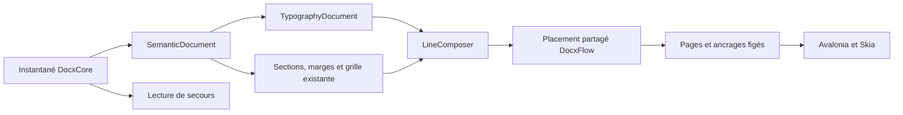

# PAGE-001B — Composition native des pages

Le profil interne `docx-flow-native-pages-v1` transforme les lignes HarfBuzz de PAGE-001A en pages physiques. Il partage avec le profil actuel l’assemblage des pages, le calcul des colonnes de tableaux, la hauteur des rangées, le placement des groupes fusionnés, la répétition des en-têtes et le chargeur borné PNG/JPEG. La lecture simplifiée, le profil paginé existant et les précontrôles d’export restent disponibles.



## Données et placement

- Une section réutilise l’intervalle de blocs, la provenance et les références d’histoires de `SemanticSection`. Une valeur déclarée en twips est convertie selon **1 twip = 635 EMU** et **1 pt = 12 700 EMU**. La région du corps soustrait les marges déclarées. Les propriétés d’en-tête, de pied, de gouttière, de colonnes et de marges miroir restent consultables. Avalonia reçoit une projection en points.
- Le type de rupture décrit le début de la section qui le déclare. La transition `continuous` partage la page quand le format, les repères et les histoires sont compatibles. Les propriétés de page manquantes dans cette transition peuvent prendre celles de la section suivante. Les transitions `nextPage`, `oddPage` et `evenPage` établissent un nouveau format physique. Un saut pair ou impair insère, si nécessaire selon la numérotation à la frontière, une feuille intercalaire au format précédent, sourcée sur les propriétés de la section qui la demande. Elle participe au total physique et reste blanche. La numérotation imprimée reste distincte de l’ordinal physique. Une reprise explicitement incompatible avec la parité du saut est diagnostiquée. [SectionProperties](https://learn.microsoft.com/en-us/dotnet/api/documentformat.openxml.wordprocessing.sectionproperties?view=openxml-3.0.1) · [SectionType](https://learn.microsoft.com/en-us/dotnet/api/documentformat.openxml.wordprocessing.sectiontype?view=openxml-3.0.1) · [Sauts Word](https://learn.microsoft.com/en-us/office/vba/api/word.wdbreaktype)
- Le placement applique `pgMar/@gutter` à la marge gauche, droite avec `rtlGutter`, ou haute avec `gutterAtTop`. Les marges miroir alternent selon l’ordinal physique. Sur la feuille opposée, elles échangent les marges latérales après prise en compte de la reliure. Les rangées de tableau et les histoires prennent la géométrie de leur occurrence. Les champs et le choix des variantes des histoires emploient la numérotation imprimée calculée par le placement. [Marges miroir OOXML](https://learn.microsoft.com/en-us/dotnet/api/documentformat.openxml.wordprocessing.mirrormargins?view=openxml-3.0.1) · [Gouttière haute OOXML](https://learn.microsoft.com/en-us/dotnet/api/documentformat.openxml.wordprocessing.gutterattop?view=openxml-3.0.1) · [Variantes Word](https://learn.microsoft.com/en-us/openspecs/office_standards/ms-oi29500/e9535962-4cf3-4279-9367-637241e4b195)
- Le `LineComposer` reçoit la largeur d’une section ou de la cellule, marges internes déduites. La grille fixe vient du lecteur LAYOUT-001B/C. Le solveur AutoFit partagé utilise, dans le profil natif, les minima et préférences déduits des avances et coupures HarfBuzz. Une cellule de continuation vide utilise l’identité et la boîte de sa fusion d’origine. Une grille insuffisante, contradictoire ou hors région bloque le placement de son tableau.
- L’espacement signé des caractères de −20 à +20 twips entre dans les avances HarfBuzz, les coupures et les largeurs intrinsèques AutoFit. Ce profil exige des clusters de gauche à droite d’une unité UTF-16 et d’un glyphe, avec une avance positive. Le soulignement simple du texte du corps suit les avances placées et les métriques de la police, avec la provenance de la propriété. Son encre respecte la boîte de ligne et les limites de la région. [Espacement OOXML](https://learn.microsoft.com/en-us/dotnet/api/documentformat.openxml.wordprocessing.spacing) · [Soulignement OOXML](https://learn.microsoft.com/en-us/dotnet/api/documentformat.openxml.wordprocessing.underline)
- Les hauteurs naturelles sont celles de PAGE-001A. Le profil applique les interlignes `auto`, `exact` ou `atLeast` et les espaces avant/après. Quand une ligne exacte est plus courte que ses métriques naturelles, elle garde sa hauteur déclarée, aligne le contenu sur le bas et l’écrête en haut. Skia et les zones de sélection emploient cette même boîte. Une marque sans encre conserve la hauteur déclarée. Un réglage de compatibilité qui change ces règles reste diagnostiqué. Les sauts explicites coupent les groupes. Le placement évalue les chaînes `keepNext`, les segments `keepLines`, les veuves et orphelines et `pageBreakBefore`. Un groupe impossible sur une page vide produit un diagnostic. [Interligne OOXML](https://learn.microsoft.com/uk-ua/dotnet/api/documentformat.openxml.wordprocessing.spacingbetweenlines.line).
- Une image inline admise par le chargeur existant apporte ses largeur et hauteur documentaires au calcul de la ligne. Sa boîte est contrôlée dans la page ou cellule. Les glyphes emploient leurs avances, positions et extents HarfBuzz. Les pixels sont dessinés par Skia à partir de ces glyphes. Les flottants complexes, notes et en-têtes n’acquièrent aucune position inventée.

## Contrat de session et de couverture

Les régions de flux partagent le placement des paragraphes et des rangées. Une
section peut définir plusieurs colonnes et une transition continue compatible
peut ouvrir une nouvelle bande sous la précédente. Les sauts internes à la
colonne précèdent le changement de feuille. Les grilles et les titres répétés
utilisent la position physique de leur région. Les largeurs inégales sont
admises si la nouvelle mesure conserve les coupures et les hauteurs, et
l’équilibrage est qualifié pour une bande de paragraphes homogènes d’une ligne.
Une reconfiguration de la largeur qui change les coupures garde un diagnostic.
[Colonnes OOXML](https://learn.microsoft.com/en-us/dotnet/api/documentformat.openxml.wordprocessing.columns.equalwidth?view=openxml-3.0.1) · [Équilibrage OOXML](https://learn.microsoft.com/en-us/dotnet/api/documentformat.openxml.wordprocessing.nocolumnbalance?view=openxml-3.0.1)

```csharp
using var lease = PageComposer.Compose(inspection, cancellation);
PageCompositionSnapshot snapshot = lease.Snapshot;
if (snapshot.Coverage == PageCoverage.Complete)
    Show(snapshot.Composition);
```

`PageCompositionSnapshot` conserve l’empreinte d’inspection, les sections, l’instantané sémantique et typographique, les lignes, les pages, les sources non placées, les diagnostics et les mesures. Un `NativePage` possède un identifiant d’instantané et un ordinal physique, la section d’origine et l’ensemble des sections qu’il contient. `PageLine.Native` conserve la géométrie des clusters et leurs étendues logiques. La ligne de base et l’origine sur la page relient ces coordonnées à l’espace de dessin. Les boîtes de cellules et d’images sont indexées par leurs sources. Les occurrences répétées restent distinguées.

- **Complete** rend les pages utilisables par Avalonia dans le profil déclaré.
- **Partial** peut conserver un préfixe calculé pour la recette. La position d’un bloc suivant un contenu non placé demeure inconnue. Une chaîne solidaire concernée peut être retirée du préfixe.
- **Fallback** signifie qu’aucune page candidate n’est conservée. Les textes, les champs stockés, les objets, les références et leurs diagnostics restent consultables via l’inspection et le modèle de lecture.

Une ligne non placée a une entrée `PagePlacementGap` avec ancre, intervalle de contexte si connu et motif. Une histoire sans région conserve ses tokens typographiques. Une géométrie partielle mesurée n’autorise aucune page dans la vue paginée native. Les dispositions et listes sont figées. Les faces restent dans le bail de composition jusqu’au remplacement ou à la fermeture du document. Le même bail sert aux miniatures et au raster de la vue. La lecture d’images conserve les limites et les ressources admises par le chargeur existant.

## Avalonia et qualification

À l’ouverture d’un DOCX lisible, Avalonia essaie automatiquement la composition native. Un instantané `Complete` ouvre toujours en Page simple et rend Double page disponible dès l’ouverture. Le profil historique monofeuille vérifié dispose des mêmes commandes et conserve son indication de profil. Lorsque la pagination reste indisponible, le lecteur affiche une explication et un accès aux diagnostics. Si le contenu est lisible, l’utilisateur peut choisir la lecture continue. Le panneau Diagnostics indique les plages sans position de page. L’inventaire conserve les notes, les champs et les objets.

### Présentation des pages physiques

La page simple empile les feuilles dans le sens de la lecture. En double page, la première feuille est à droite, puis les paires 2–3 et 4–5 suivent. Les feuilles d’une paire sont alignées par le haut et séparées par une gouttière de 24 DIP. Un côté vide montre le fond du lecteur. Une feuille blanche physique provient de l’instantané, avec son ordinal.

Chaque feuille réutilise son `NativePage` pour l’identité, les dimensions et la géométrie dessinée. À 100 %, un point correspond à 96/72 DIP. Le zoom et les tiroirs modifient l’affichage. Les coupures, les formats et les coordonnées de l’instantané restent stables. Un seul viewport fait défiler la présentation paginée dans les deux axes. Les feuilles hors champ ne sont pas réalisées. Par ouverture, le cache de rasters réutilise le dessin à une même échelle et vise une borne de 16 millions de pixels décodés, avec une limite par feuille. La sélection par cluster et les marques utilisent les coordonnées locales de la feuille. Les ancres de sommaire révèlent la page ou la paire correspondante.

Les témoins `PageViewCases.cs` génèrent leurs paragraphes, signets, histoires de page et renvois de note dans des paquets synthétiques. Les captures, copies privées et mesures restent dans la qualification locale. Les modes de vue réutilisent les précontrôles d’export existants.

Les actions de navigation, miniatures, zoom, règle et marques utilisent les pages calculées. La vue native relie la recherche à des rectangles de clusters dans la page trouvée. Le clic dans le texte sélectionne le cluster visible et conserve ses étendues OOXML. Le surlignage et les marques forment des calques. L’adoption d’une nouvelle ouverture écarte le bail précédent. Un changement de région demande une recomposition sur l’instantané, suivie par la publication d’une nouvelle génération complète.

La recette distingue les données mesurées de la pagination complète. Les rasters des témoins démontrent le dessin du profil exercé. Les PDF Word de référence, la fidélité Word, la sélection continue entre pages et la publication progressive restent à qualifier. Les travaux suivants portent sur les colonnes et leurs transitions, les positions de notes et de flottants, les histoires hors des régions actuelles, les champs recalculés, les listes complexes, les régions conditionnelles des tableaux et les rangées fragmentées. [PAGE-001A](composition-lignes-page-001a.md) · [Contrats ARCH-001](architecture-docx/05-contrats.md)

## Collections de styles

Le compositeur sélectionne la collection ordinaire par sa relation OPC. En présence d’une collection auxiliaire valide, le mode 12 explicite ou implicite active le profil ECMA-376, qui reproduit le traitement de la relation auxiliaire comme inconnue dans Word 2007. Le modèle conserve les deux racines, leurs valeurs par défaut, leurs définitions et leurs chaînes. Le mode décrit le jeu de fonctionnalités enregistré. Pour les autres modes reconnus, le départage des divergences actives reste à établir. [Partie auxiliaire MS-DOCX](https://learn.microsoft.com/en-us/openspecs/office_standards/ms-docx/6d73a0c5-2d94-461e-81c8-843ad0e911a6) · [Comportement des versions](https://learn.microsoft.com/en-us/openspecs/office_standards/ms-docx/11e00e62-c73a-4371-93d5-cddcc63fcbf0) · [Mode de compatibilité](https://learn.microsoft.com/en-us/openspecs/office_standards/ms-docx/90138c4d-eb18-4edc-aa6c-dfb799cb1d0d).

Lorsque le profil exige de comparer les déclarations actives, les attributs sont comparés par nom développé. Les listes MCE sont comparées comme des ensembles d’espaces de noms ou de noms développés, résolus dans leur portée XML. L’ordre des branches et le premier choix admissible continuent de déterminer le contenu actif. Une propriété de rendu divergente, une dépendance ambiguë ou un style actif absent maintient la couverture partielle. [ECMA-376, partie 3](https://ecma-international.org/publications-and-standards/standards/ecma-376/).

Le type et la couleur du soulignement sont hérités séparément. La couleur de thème est résolue avant transformation HSL. Une teinte déclarée prime sur l’ombre. La composition mesure et peint les traits simples pris en charge à partir de ces propriétés et conserve leurs sources. [Soulignement Word](https://learn.microsoft.com/en-us/openspecs/office_standards/ms-oi29500/983b4d5a-53ba-4d79-89cb-fc13303af71b) · [Couleur du texte Word](https://learn.microsoft.com/en-us/openspecs/office_standards/ms-oi29500/8229a077-7fc8-4fba-96cc-c77b6a4fc768).

## Dépendances XML bibliographiques

Le profil natif distingue une collection sans effet démontré sur la composition, une collection consommée par un champ ou une liaison et un effet indéterminé. La première donne un diagnostic informatif. Son admission exige une relation interne unique, une collection bibliographique identifiée, les propriétés du magasin et l’examen des consommateurs sur l’ensemble de l’inventaire XML. Un champ de fonction indéterminée, une relation ambiguë ou un autre type de magasin maintient un diagnostic bloquant. Le moteur conserve les entrées et leurs identifiants sans exécuter de requête sur le magasin ni ajouter de texte visible. Les contrôles d’export gardent leur propre décision. [Magasins XML](https://learn.microsoft.com/en-us/openspecs/office_standards/ms-oi29500/b5ea0047-2119-4ae5-94a1-63c27af037dd) · [Champs bibliographiques](https://learn.microsoft.com/en-us/openspecs/office_standards/ms-oi29500/70651763-1bd2-4fa2-ae94-420b4a980998).

## Dessins flottants du corps

Le profil natif admet un dessin ancré en tête d’un paragraphe du corps lorsque ses dimensions et sa position sont résolues sans habillage. Les offsets horizontaux partent de la page, de la marge ou de la colonne unique, et les offsets verticaux de la page ou de la marge. L’occurrence appartient à la feuille où le paragraphe est placé. Le dessin conserve son ancre et son ordre de couche. Skia coupe l’encre aux limites physiques et respecte la disposition de la couche derrière ou devant le texte. Le contrôle source conserve une avance nulle en typographie.

Une paire de pourcentages relatifs nuls est admise avec une étendue absolue concordante. Les JPEG Adobe CMJN baseline peuvent être décodés en sRGB lorsque la séquence ICC et ses tables respectent le profil borné. L’image d’origine conserve son empreinte. Le raster applique le rognage intérieur et les retournements de l’occurrence. L’étendue d’effet intervient dans le contrôle d’encre et dans la hauteur d’une ligne avec image intégrée. Le profil de l’habillage haut/bas place un dessin de tête de paragraphe avec sa réserve de hauteur avant la première ligne. La réserve et l’ancre changent de colonne ou de feuille ensemble. Un rectangle WPS transparent sans habillage peut recevoir une ligne de texte sur la feuille quand les branches WPS et VML portent le même contenu et les mêmes propriétés de texte. Le placement emploie les coordonnées WPS et la ligne HarfBuzz issue du texte sémantique local. Les formes riches, les histoires, les autres profils d’habillage, les collisions avec repositionnement et les aperçus OLE demandent encore une qualification. [Ancrage OOXML](https://learn.microsoft.com/en-us/dotnet/api/documentformat.openxml.drawing.wordprocessing.anchor) · [Habillage haut/bas](https://learn.microsoft.com/en-us/dotnet/api/documentformat.openxml.drawing.wordprocessing.wraptopbottom?view=openxml-3.0.1) · [Rectangle source](https://learn.microsoft.com/en-us/dotnet/api/documentformat.openxml.drawing.sourcerectangle?view=openxml-3.0.1)

## Histoires de page

Les références d’en-tête et de pied sont héritées par type de variante. `titlePg` donne la priorité à la première page et `evenAndOddHeaders` active la sélection paire à partir de la numérotation de section. L’ordinal physique et cette numérotation restent distincts. Les tableaux, images intégrées et lignes réutilisent les compositeurs existants. Une histoire est mesurée pour son format et ancrée à la distance publiée depuis le bord haut ou bas. Une histoire qui déborde vers le corps reçoit un diagnostic de chevauchement. Les changements d’histoire en section continue et les recompositions interdépendantes restent à qualifier. [Héritage Word des en-têtes](https://learn.microsoft.com/en-us/openspecs/office_standards/ms-oi29500/5de15e59-3ec1-4f80-aa4d-00bdd447b86f) · [Parité selon la numérotation déclarée](https://learn.microsoft.com/lb-lu/openspecs/office_standards/ms-oi29500/e9535962-4cf3-4279-9367-637241e4b195).

Après stabilisation du corps, un `PAGE` terminal par paragraphe auxiliaire peut être calculé dans chaque occurrence sélectionnée, y compris dans une cellule. Un champ complexe vérifié peut répartir son instruction sur plusieurs runs. Le résultat calculé utilise le style qualifié de son résultat et les glyphes mesurés avant le calcul de la ligne ou de la grille. Le placement contrôle ensuite la cellule et le chevauchement avec le corps. Un cache verrouillé exploitable s’affiche comme stocké. Le modèle d’inspection conserve les résultats OOXML, même lorsqu’un résultat calculé les remplace sur la page. Un calcul hors profil bloque la couverture complète et conserve sa provenance.

Les histoires désactivées et les variantes jamais sélectionnées gardent leurs déclarations dans l’inventaire. La composition auxiliaire borne le nombre de gabarits, de paragraphes, de valeurs mises en cache, de glyphes mesurés et d’occurrences. Le plafond des diagnostics réserve une capacité aux erreurs bloquantes. La synthèse des messages informatifs indique que l’inventaire des observations a été abrégé.

## Renvois du corps

Les champs de page sans cache admis sont mesurés à la fin de leur paragraphe, y compris dans le résultat visible d’un TOC. Le calcul réutilise la cascade de caractères du résultat et enregistre une décoration HarfBuzz sans étendue documentaire. Les caches verrouillés exploitables restent dans le texte source. Les caches dynamiques non vides et les champs hors profil conservent un diagnostic.

Une première géométrie de travail réserve la largeur d’un chiffre. Les passes suivantes recomposent les seuls paragraphes dont le résultat change et recalculent le placement à partir des mêmes régions. La qualification compare les numéros, les pages et positions des signets, les coupures de ligne, les pages et la géométrie des cellules. Elle se limite à quatre passes de travail sous les budgets de composition. Un cycle, une cible non placée ou une contrainte de placement bloquante empêche l’adoption. Si les champs restent indéterminés, le préfixe sûr est composé à partir du seul contenu d’origine.

Le début d’un signet apparié détermine la page de sa cible. Le placement conserve l’ordinal physique et la numérotation de section. Le total physique est calculé quand le corps est complet. Les liens internes qualifiés et les rectangles des libellés calculés exploitent l’ancre stabilisée. La recherche, la sélection et la copie utilisent les étendues source. Les histoires auxiliaires de région fixe sont composées après le corps.

## Marqueurs TC et sommaire enregistré

Le modèle sémantique conserve le libellé du marqueur TC, son groupe, son niveau, la demande d’omettre le numéro et le rattachement aux sélecteurs TOC pris en charge. Dans le profil des opérandes imbriqués, le libellé utilise les résultats enregistrés des champs REF et SEQ admis. Leurs sources restent distinctes des fragments visibles. Le placement poursuit la composition contenant ces marqueurs, sans glyphes ni avance pour le marqueur. Un paragraphe réel conserve sa marque et ses contraintes. Une structure irrégulière garde ses diagnostics.

Le TOC affiché reste celui enregistré, avec les titres et liens d’origine. Le rapprochement avec les marqueurs n’ajoute aucune entrée. Le calcul des PAGEREF du corps suit la stabilisation multipasse et la disponibilité de la composition dépend aussi des histoires auxiliaires. [Champ TC](https://support.microsoft.com/en-gb/word/field-codes-tc-table-of-contents-entry-field)
