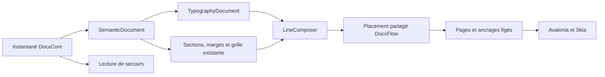

# PAGE-001B — Composition native des pages

Le profil interne `docx-flow-native-pages-v1` transforme les lignes HarfBuzz de PAGE-001A en pages physiques. Il partage avec le profil actuel l’assemblage des pages, le calcul des colonnes de tableaux, la hauteur des rangées, le placement des groupes fusionnés, la répétition des en-têtes et le chargeur borné PNG/JPEG. La lecture simplifiée, le profil paginé existant et les précontrôles d’export restent disponibles.



## Données et placement

- Une section réutilise l’intervalle de blocs, la provenance et les références d’histoires de `SemanticSection`. Une valeur déclarée en twips est convertie selon **1 twip = 635 EMU** et **1 pt = 12 700 EMU**. La région du corps soustrait les marges déclarées. Les propriétés d’en-tête, de pied, de gouttière, de colonnes et de marges miroir restent consultables. Avalonia reçoit une projection en points.
- Le type de rupture décrit le début de la section qui le déclare. La transition `continuous` partage la page quand le format, les repères et les histoires sont compatibles. Les propriétés de page manquantes dans cette transition peuvent prendre celles de la section suivante. Une transition `nextPage` établit un nouveau format physique. Un saut pair/impair ou une transition incompatible conserve la provenance et empêche le placement à partir de cette frontière. [SectionProperties](https://learn.microsoft.com/en-us/dotnet/api/documentformat.openxml.wordprocessing.sectionproperties?view=openxml-3.0.1) · [SectionType](https://learn.microsoft.com/en-us/dotnet/api/documentformat.openxml.wordprocessing.sectiontype?view=openxml-3.0.1).
- Le `LineComposer` reçoit la largeur d’une section ou de la cellule, marges internes déduites. La grille fixe vient du lecteur LAYOUT-001B/C. Le solveur AutoFit partagé utilise, dans le profil natif, les minima et préférences déduits des avances et coupures HarfBuzz. Une cellule de continuation vide utilise l’identité et la boîte de sa fusion d’origine. Une grille insuffisante, contradictoire ou hors région bloque le placement de son tableau.
- Les hauteurs naturelles sont celles de PAGE-001A. Le profil applique les interlignes `auto`, `exact` ou `atLeast` et les espaces avant/après. Une hauteur exacte qui clippe le contenu est refusée. Les sauts explicites coupent les groupes. Le placement évalue les chaînes `keepNext`, les segments `keepLines`, les veuves et orphelines et `pageBreakBefore`. Un groupe impossible sur une page vide produit un diagnostic.
- Une image inline admise par le chargeur existant apporte ses largeur et hauteur documentaires au calcul de la ligne. Sa boîte est contrôlée dans la page ou cellule. Les glyphes emploient leurs avances, positions et extents HarfBuzz. Les pixels sont dessinés par Skia à partir de ces glyphes. Les flottants complexes, notes et en-têtes n’acquièrent aucune position inventée.

## Contrat de session et de couverture

```csharp
using var lease = PageComposer.Compose(inspection, cancellation);
PageCompositionSnapshot snapshot = lease.Snapshot;
if (snapshot.Coverage == PageCoverage.Complete)
    Show(snapshot.Composition);
```

`PageCompositionSnapshot` conserve l’empreinte d’inspection, les sections, l’instantané sémantique et typographique, les lignes, les pages, les sources non placées, les diagnostics et les mesures. Un `NativePage` possède un identifiant d’instantané et un ordinal physique, la section d’origine et l’ensemble des sections qu’il contient. `PageLine.Native` conserve la géométrie des clusters et leurs étendues logiques. La ligne de base et l’origine sur la page relient ces coordonnées à l’espace de dessin. Les boîtes de cellules et d’images sont indexées par leurs sources. Les occurrences répétées restent distinguées.

- **Complete** rend les pages utilisables par Avalonia dans le profil déclaré.
- **Partial** peut conserver un préfixe calculé pour la recette. La position d’un bloc suivant un contenu non placé demeure inconnue. Une chaîne solidaire concernée peut être retirée du préfixe.
- **Fallback** signifie qu’aucune page candidate n’est conservée. Les textes, les champs stockés, les objets, les références et leurs diagnostics restent consultables via l’inspection et le modèle de lecture.

Une ligne non placée a une entrée `PagePlacementGap` avec ancre, intervalle de contexte si connu et motif. Une histoire sans région conserve ses tokens typographiques. Une géométrie partielle mesurée n’autorise aucune page dans la vue paginée native. Les dispositions et listes sont figées. Les faces restent dans le bail de composition jusqu’au remplacement ou à la fermeture du document. Le même bail sert aux miniatures et au raster de la vue. La lecture d’images conserve les limites et les ressources admises par le chargeur existant.

## Avalonia et qualification

Le choix expérimental `LECTEUR_WORD_PAGE_PROFILE=native` active la proposition native au prochain lancement. Le parcours courant reste le profil précédent. Même en mode expérimental, Avalonia adopte uniquement un résultat `Complete`. Si la proposition est partielle, le lecteur conserve le chemin précédemment qualifié ou utilise la lecture simplifiée. Le panneau Diagnostics peut montrer les plages sans position, et l’inventaire conserve les notes et objets.

Les actions de navigation, miniatures, zoom, règle et marques utilisent les pages calculées. La vue native relie la recherche à des rectangles de clusters dans la page trouvée. Le clic dans le texte sélectionne le cluster visible et conserve ses étendues OOXML. Le surlignage et les marques forment des calques. L’adoption d’une nouvelle ouverture écarte le bail précédent. Un changement de région demande une recomposition sur l’instantané, suivie par la publication d’une nouvelle génération complète.

La recette distingue les données mesurées de la pagination complète. Les rasters des témoins démontrent le dessin du profil exercé. Les PDF Word de référence, la fidélité Word, la sélection continue entre pages et la publication progressive restent à qualifier. Les travaux suivants portent sur les positions de notes et de flottants, les en-têtes/pieds, les champs recalculés, les listes complexes, les régions conditionnelles de tableau, les lignes fragmentées, les transitions pair/impair et les colonnes. [PAGE-001A](composition-lignes-page-001a.md) · [Contrats ARCH-001](architecture-docx/05-contrats.md).

## Collections de styles

Le compositeur construit les pages candidates avec la collection ordinaire validée par sa relation OPC. Le modèle conserve les deux racines, leurs valeurs par défaut, leurs définitions et leurs chaînes indépendantes. Le mode de compatibilité indique le jeu de fonctions du dernier enregistrement. L’annexe Microsoft documente la reconnaissance et l’écriture de la partie auxiliaire suivant la version de Word. Ces règles laissent le départage de collections divergentes indéterminé pour un document donné. [Partie auxiliaire MS-DOCX](https://learn.microsoft.com/en-us/openspecs/office_standards/ms-docx/6d73a0c5-2d94-461e-81c8-843ad0e911a6) · [Comportement des versions](https://learn.microsoft.com/en-us/openspecs/office_standards/ms-docx/11e00e62-c73a-4371-93d5-cddcc63fcbf0) · [Mode de compatibilité](https://learn.microsoft.com/en-us/openspecs/office_standards/ms-docx/90138c4d-eb18-4edc-aa6c-dfb799cb1d0d).

La comparaison des déclarations actives admet les écritures équivalentes des booléens pris en charge et les différences de métadonnées d’interface ou d’édition. Une propriété de rendu divergente, une dépendance ambiguë ou un style actif absent maintient la couverture partielle. Les propriétés typographiques et les métriques conservent la provenance des déclarations retenues.

## Dépendances XML bibliographiques

Le profil natif distingue une collection sans effet démontré sur la composition, une collection consommée par un champ ou une liaison et un effet indéterminé. La première donne un diagnostic informatif. Son admission exige une relation interne unique, une collection bibliographique identifiée, les propriétés du magasin et l’examen des consommateurs sur l’ensemble de l’inventaire XML. Un champ de fonction indéterminée, une relation ambiguë ou un autre type de magasin maintient un diagnostic bloquant. Le moteur conserve les entrées et leurs identifiants sans exécuter de requête sur le magasin ni ajouter de texte visible. Les contrôles d’export gardent leur propre décision. [Magasins XML](https://learn.microsoft.com/en-us/openspecs/office_standards/ms-oi29500/b5ea0047-2119-4ae5-94a1-63c27af037dd) · [Champs bibliographiques](https://learn.microsoft.com/en-us/openspecs/office_standards/ms-oi29500/70651763-1bd2-4fa2-ae94-420b4a980998).

## Histoires de page

Les références d’en-tête et de pied sont héritées par type de variante. `titlePg` donne la priorité à la première page et `evenAndOddHeaders` active la sélection paire à partir de la numérotation de section. L’ordinal physique et cette numérotation restent distincts. Les tableaux, images intégrées et lignes réutilisent les compositeurs existants. Une histoire est mesurée pour son format et ancrée à la distance publiée depuis le bord haut ou bas. Une histoire qui déborde vers le corps reçoit un diagnostic de chevauchement. Les changements d’histoire en section continue et les recompositions interdépendantes restent à qualifier. [Héritage Word des en-têtes](https://learn.microsoft.com/en-us/openspecs/office_standards/ms-oi29500/5de15e59-3ec1-4f80-aa4d-00bdd447b86f) · [Parité selon la numérotation déclarée](https://learn.microsoft.com/lb-lu/openspecs/office_standards/ms-oi29500/e9535962-4cf3-4279-9367-637241e4b195).

Les valeurs de champ affichables sont celles stockées dans le DOCX. Un champ exigeant une mise à jour de pagination bloque la publication complète tant que ce calcul reste hors profil. Une histoire désactivée ou une variante jamais sélectionnée garde ses déclarations dans l’inventaire. Les mises en page auxiliaires sont limitées à 128 gabarits, 2 048 paragraphes par histoire et 60 000 occurrences de lignes et cellules.
