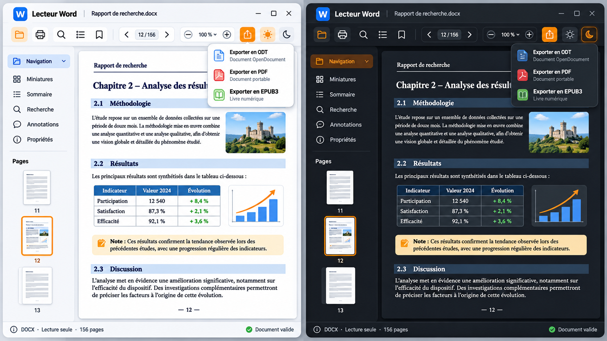

# Maquette de référence — Lecteur Word

Référence visuelle approuvée par le propriétaire le **20 novembre 2026**, intégrée sans conversion à sa demande pour le dépôt privé.



- Fichier : `docs/maquettes/lecteur-word-maquette-clair-sombre.png`.
- Dimensions : **1672 × 941 pixels**.
- SHA-256 : `079276d8a88699c393622cd1500c1b753c6dc47cbcc03d75d00f4948105aa177`.

Depuis la racine du projet :

```sh
sha256sum "docs/maquettes/lecteur-word-maquette-clair-sombre.png"
```

Les octets et le bloc de provenance du PNG sont conservés. La [revue de provenance](../provenance.md) distingue cette ressource autorisée des captures et documents personnels exclus de Git.

La maquette n'est pas une capture d'une application fonctionnelle. Le prototype, ses limites et ses fonctionnalités prévues sont décrits dans le [README principal](../../README.md). Le papier du document reste blanc en thème sombre dans le prototype actuel.
