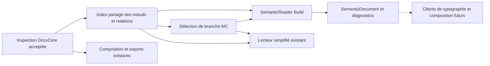

# SEMANTIC-001 · Modèle documentaire DocxFlow

Le point d’entrée interne `SemanticReader.Build(InspectionResult, CancellationToken)` construit un `SemanticDocument` à partir de l’inventaire accepté par DocxCore. Il renvoie ce document avec ses diagnostics ou un résultat de refus. L’inventaire et les ressources de l’inspection sont la source de vérité. Les propriétés non interprétées restent accessibles par leur QName, leur valeur et leur identifiant source. La conception suit le premier lot d’ARCH-001. [Modèle prévu](architecture-docx/02-modele.md) · [Contrats prévus](architecture-docx/05-contrats.md).

La lecture simplifiée réutilise le même index que ses aides de présentation. Elle consomme la règle de choix MC et les relations indexées. `SemanticReader.Build` peut être appelé indépendamment pour préparer un futur consommateur de composition. L’ouverture ordinaire ne matérialise pas deux graphes de présentation. Les clients de composition et d’export existants gardent leur entrée. Le manifeste v1 ne porte aucun champ nouveau.

## Contrat utilisable dans DocxFlow

| Structure | Identité, contenu et accès |
|---|---|
| `SemanticDocument`, `SemanticElement` | SHA-256 du snapshot et identifiants d’inventaire. Ordre source stable, index par ID, QNames, parents, attributs et texte accessibles. Couverture sémantique distincte de la fidélité de rendu |
| `SemanticSource`, `Utf16Span` | Partie et chemin repris de DocxCore. Étendue demi-ouverte dans la valeur XML décodée. Refus d’un offset qui coupe une paire de surrogates. `TextSource` donne l’étendue de la valeur complète |
| `SemanticStory`, `BodyBlocks`, `BlocksOf`, `Children` | Corps, en-têtes/pieds, notes, commentaires et zones de texte. Enfants bruts ou projetés dans l’ordre. Les graphes partagent les mêmes IDs. Les histoires ne répètent pas les corps sous leurs appels |
| `SemanticSection`, `RunningStory` | Intervalle d’indices dans le corps, propriétés Word et paragraphe de clôture si présents. En-tête/pied par variante, origine de la déclaration et lien à l’histoire. La déclinaison sur des pages physiques reste au compositeur |
| `SemanticStyleCollection`, `SemanticStyleCompatibility`, `SemanticStyleUse`, `PresentationDeclarations` | Relations et racines des deux collections, valeurs par défaut, chaînes base→dérivé propres à chaque partie et source du mode de compatibilité. La cascade candidate expose les déclarations ordinaires, leurs sources, les propriétés directes et le `rPr` distinct de la marque de paragraphe |
| `SemanticCustomXml` | Relation et partie XML, magasin et entrées bibliographiques quand identifiables, source d’un consommateur et effet documenté sur la composition. Les valeurs éditoriales restent référencées par leurs nœuds de l’inventaire |
| `SemanticNumbering` | Instance, définition abstraite, niveau et surcharge rattachés quand démontrés. Sources de sélection du numéro et du niveau. `numId=0` signale une suppression. Les définitions et leurs propriétés, dont redémarrages, restent consultables sans générer de libellé |
| `SemanticTable`, `SemanticRow`, `SemanticCell` | Grille et positions logiques, déclarations et contenus des cellules, spans, origine de fusion verticale ou horizontale reconnue. Une continuation dont l’origine n’est pas prouvée reçoit un diagnostic |
| `SemanticReference` | ID déclaré dans la partie appelante, relation OPC, cible inventoriée ou média identifié si établi. États résolu, externe, irrésolu et inerte. Notes et commentaires rattachés à leur corps par relation et ID. Signets liés dans leur histoire et références nommées résolues lorsqu’elles sont uniques |
| `SemanticField` | Simple ou complexe, par histoire, avec imbrication, marqueurs, statut structurel, dirty/locked, instruction et résultat stocké en listes de sources. Les commandes TOC, REF, PAGEREF et NOTEREF peuvent être distinguées. Le lien vers un signet est facultatif. Le moteur ne produit aucune valeur calculée |
| `SemanticAlternative` | ID des branches brutes, choix retenu ou état irrésolu. Les éléments des branches écartées sont accessibles avec leur couverture inactive, sans être projetés dans le flux de lecture |
| Dessins, révisions, commentaires, objets opaques | Points d’ancrage, dessins inline/flottants, métadonnées, zones de texte et média distincts. Les révisions et contrôles restent identifiés. Un objet inconnu ou actif expose son inventaire, ses attributs, sa relation et un diagnostic, sans exécution |

Les types internes produisent des valeurs et collections figées. Ils s’appuient sur les nœuds et chaînes de l’inspection existante. Le modèle emprunte ce snapshot en lecture seule pendant sa durée de vie. Le contrat v1 contient des types mutables et l’appelant doit garder le snapshot intact. La couche sémantique évite une copie de l’arbre XML, du texte, des attributs et des binaires. Les tableaux de champs et fusions contiennent des références aux mêmes nœuds. Aucune source n’est rouverte après l’inspection.

## Règles et limites

- Partir de la relation racine du document principal. Résoudre les relations par (partie source, ID), contrôler le type attendu. Pour notes, en-têtes, pieds et commentaires, lier uniquement une source unique dans la partie attendue. Les ancres ou relations ambiguës restent signalées. Aucun téléchargement ni exécution.
- Dans `mc:AlternateContent`, résoudre les préfixes dans la portée lexicale de chaque Choice. Ce premier profil sélectionne le premier Choice dont toutes les exigences correspondent au WML pris en charge par la projection. Il choisit sinon un Fallback unique. Une absence de sélection ou un MustUnderstand inconnu reçoit un diagnostic. Les autres extensions de compatibilité restent des données inventoriées. [ECMA-376, partie 3](https://ecma-international.org/publications-and-standards/standards/ecma-376/) · [Introduction Microsoft](https://learn.microsoft.com/en-us/office/open-xml/general/introduction-to-markup-compatibility).
- Délimiter les sections par `pPr/sectPr` et la déclaration finale du corps. Conserver les déclarations de variantes et l’origine de leur héritage. La sélection première/paire se fera lors du placement. [Propriétés de section](https://learn.microsoft.com/en-us/dotnet/api/documentformat.openxml.wordprocessing.sectionproperties?view=openxml-3.0.1) · [Référence d’en-tête](https://learn.microsoft.com/en-us/dotnet/api/documentformat.openxml.wordprocessing.headerreference?view=openxml-3.0.1).
- Résoudre la chaîne des styles dans la partie liée, avec arrêt sur cycle, ambiguïté ou type incompatible. Pour une numérotation héritée, prendre le niveau lié par `lvl/pStyle` lorsque sa résolution est certaine. Garder les propriétés de thème, tableaux, révision et compatibilité même si leurs valeurs effectives dépassent ce lot. [Numérotation OOXML](https://learn.microsoft.com/en-us/dotnet/api/documentformat.openxml.wordprocessing.numberingproperties?view=openxml-3.0.1).
- La fusion verticale utilise une cellule de même colonne et largeur logique dans la rangée précédente. L’origine horizontale doit être établie par un début de fusion dans la même rangée. La grille conserve les dimensions déclarées et les écarts. Le calcul des largeurs reste au compositeur. [Fusion verticale](https://learn.microsoft.com/en-us/dotnet/api/documentformat.openxml.wordprocessing.verticalmerge?view=openxml-3.0.1) · [Fusion horizontale](https://learn.microsoft.com/en-us/dotnet/api/documentformat.openxml.wordprocessing.horizontalmerge?view=openxml-3.0.1).
- Les champs simples et complexes gardent le texte enregistré. Le contenu d’une histoire distincte ne clôture jamais un champ de l’histoire parente. Une structure ambiguë est diagnostiquée. `StoredResultIds` est la référence d’autorité, et la commodité `StoredText` ne rend qu’une projection textuelle éventuellement absente. Le prochain lot définira la politique de révision et l’analyse des champs complexes au-delà du préfixe de commande et d’une référence simple. [Marqueurs de champ](https://learn.microsoft.com/en-us/dotnet/api/documentformat.openxml.wordprocessing.fieldchar?view=openxml-3.0.1).
- Les quotas d’entrée DocxCore restent le premier garde. La construction ajoute une limite de 150 000 nœuds, 5 millions de contrôles coopératifs, 10 s, profondeur de champ 32 et 4 096 détails de diagnostic avant résumé. Les limites n’accordent aucune borne dure sur une allocation native. Le modèle sémantique ne décode ni fonte ni média. Un refus conserve l’inventaire d’entrée et l’annulation se propage.

Le prochain lot utilisera les spans, couches de style et identités pour former des runs de texte et les mesurer. La cascade complète, les révisions comme projection de rendu, la sélection géométrique, les régions-interfaces, le calcul des champs et le rendu spécialisé restent à qualifier. Les structures ajoutées n’attribuent aucune position physique. La qualification Microsoft Word nécessite les couples de référence d’ARCH-001.
