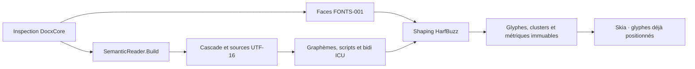

# TEXT-001 — Contrat typographique de DocxFlow

Le lot ajoute un chemin interne de mesure et de dessin de fragments à partir de `SemanticReader.Build`. L’application Avalonia utilise toujours le compositeur C# qualifié avant ce lot. PAGE-001 pourra brancher le nouveau contrat après avoir qualifié les lignes, leur réordonnancement et les contraintes géométriques. [Architecture typographique](architecture-docx/03-typographie.md) · [Contrats ARCH-001](architecture-docx/05-contrats.md) · [Modèle SEMANTIC-001](modele-semantique.md).

## Utilisation et systèmes de coordonnées

| Contrat interne | Rôle |
| --- | --- |
| `TypographySession(inspected, semantic, limits, cancellation)` | Vérifie l’identité du snapshot, prépare les faces et lie la durée de vie des caches au document. Une session par document. Les appels actifs sont sérialisés par l’appelant. |
| `Measure(cancellation)` → `TypographyDocument` | Fournit les données immuables, l’identité du snapshot, les versions ICU/Unicode, les diagnostics et les temps par phase. Un dépassement de budget lève une exception diagnostiquée. L’appelant garde l’accès au modèle sémantique. |
| `TextToken` | Texte original et source, identifiants de run, paragraphe et story. Rôles distincts pour texte courant, résultat de champ stocké, instruction, texte supprimé, branche inactive, contrôle et texte hors profil. |
| `TextParagraph` | Fragments en ordre logique, ordre visuel à l’échelle du paragraphe, direction et éventuelle source, style de marque, contrôles et opportunités de coupure. |
| `TextFragment` et `TextSlice` | Texte exact, liste des plages contiguës dans ce fragment, identifiants et plages UTF‑16 des nœuds d’origine. Style, langue, script ISO 15924, niveau bidi, slot, requête, thème, face éventuelle et options OpenType. |
| `TextMeasure`, `TextGlyph`, `TextCluster` | Largeur, ascendant, descendant, interligne de face, ligne de base et boîte d’encre éventuelle. Positions et avances en EMU entiers, à raison de 12 700 par point. Les positions partent de la ligne de base et l’axe Y descend comme dans Skia. Le cluster expose sa plage logique et les indices contigus des glyphes. |
| `TextBlob(fragment)`, `Paint(canvas, fragment, x, baseline, color)` | Même face figée, même taille, mêmes identifiants et positions de glyphes. Les coordonnées d’appel sont en points. Skia consomme le blob positionné sans reformer ni remesurer la chaîne. |

Les offsets `ContextOffset` et `TextParagraph.Breaks` sont propres au paragraphe dans une chaîne temporaire. Les offsets de clusters et de coupures de fragment sont locaux au fragment. Pour obtenir une position documentaire, intersecter la plage locale avec les tranches `TextSlice.FragmentRange` et traduire chaque intersection vers le `SemanticSource.Span` associé. Les plages sont semi-ouvertes. Un cluster peut associer plusieurs glyphes ou plusieurs nœuds, ou couvrir un caractère ignorable sans glyphe. Le choix de l’offset de sélection appartient à PAGE-001. Les tranches autorisent des sélections aux bornes de clusters et conservent les paires UTF‑16. [HarfBuzz, clusters](https://harfbuzz.github.io/working-with-harfbuzz-clusters.html) · [HarfBuzz, tampon](https://harfbuzz.github.io/harfbuzz-hb-buffer.html).

Pour le contexte ICU, une tabulation ou un saut reçoit un caractère de contrôle temporaire, et un objet opaque reçoit un marqueur. Ces caractères ont un `TextControl` qui renvoie au nœud sémantique. Les contrôles, les instructions et les résultats de champs stockés gardent leurs rôles respectifs. La largeur d’une tabulation, la présentation d’un symbole `w:sym` et l’activation du trait d’un `w:softHyphen` relèvent de la future composition de ligne.

Les bornes proposées par ICU sont filtrées par les graphèmes, les clusters et le drapeau HarfBuzz `UnsafeToBreak`. Les limites d’objets forcent des bornes de contexte. Une locale de ligne unique est appliquée au paragraphe lorsqu’elle est déterminée. En cas de langues mixtes, la locale racine s’applique avec diagnostic. L’itemisation donne un script principal à chaque graphème et rattache les caractères neutres à un script voisin de niveau compatible. Le bidi paragraphe prend en compte `w:bidi`. Les règles de forçage Word de `w:rtl` et les extensions de script restent partielles. [Segmentation ICU](https://unicode-org.github.io/icu/userguide/boundaryanalysis/) · [Bidi ICU](https://unicode-org.github.io/icu-docs/apidoc/released/icu4c/ubidi_8h.html) · [Propriété OOXML w:rtl](https://learn.microsoft.com/en-us/dotnet/api/documentformat.openxml.wordprocessing.righttolefttext?view=openxml-3.0.1).

## Matrice de la cascade

| Entrée | Résolution du profil | Traçabilité |
| --- | --- | --- |
| Valeurs documentaires, tables, paragraphes et caractères | Les déclarations vont des valeurs documentaires aux styles de table généraux et `wholeTable`, puis aux chaînes de paragraphe et de caractère, puis aux propriétés directes. Les chaînes parcourent `basedOn` du parent vers le dérivé. | Source de chaque valeur effective. Référence non résolue signalée. Les déclarations de région de table restent accessibles dans le modèle sémantique avec diagnostic. |
| Marque de paragraphe | Résolution distincte. Le `rPr` direct du `pPr` s’applique à la marque. | Style de marque dans `TextParagraph.MarkStyle`. |
| Police et thème | Slots ASCII, hAnsi, eastAsia et cs. Thème suivi jusqu’à la famille. Repli des familles par FONTS-001. `hint` et variantes Han restent partiels. | Requête et provenance par slot, source du thème, face effective, index, SHA-256, couverture et raison du repli. |
| Corps et caractères complexes | Graisse, italique, taille, variantes cs, décalage de ligne de base, espacement. Les propriétés booléennes de style concernées suivent les règles OOXML de bascule. | Origine des propriétés déclarées. La valeur initiale de profil, dont les 12 pt en l’absence de taille, a une provenance vide. |
| Couleur, soulignement et visibilité | Couleur directe ou thème simple, `auto` laissé à l’appelant, type de soulignement, texte masqué conservé parmi les tokens. Les transformations de couleur et les propriétés hors profil donnent un diagnostic. Le dessin de fragment couvre les glyphes et leur couleur. | Provenance de la déclaration et éventuelle cible de thème. Les décorations de ligne seront dessinées à partir des métriques par PAGE-001. |
| Direction, écritures et langue | Bidi et graphèmes ICU, sélection du slot selon le script et les propriétés complexes. Langues normale, asiatique et bidi distinctes. | Origine du `bidi`, du `rtl`, du `cs` et des valeurs déclarées. |
| OpenType | Seuil de crénage `w:kern`, contrôles de ligatures `w14:ligatures`, fonctionnalités par défaut du shaper pour le script. | Liste des paramètres transmis à HarfBuzz. Déclarations supplémentaires hors profil signalées. |

Une déclaration inconnue, invalide ou partiellement résolue reste dans le modèle. Le profil indique quelle propriété pose problème. Pour un conflit de style à l’intérieur d’un graphème ou une absence de face couvrante, la mesure du fragment est absente. Un glyphe zéro après shaping produit `TEXT_NOTDEF` et marque le cluster concerné. Le lecteur de pages devra traiter ces états comme une couverture partielle. [OOXML, bascules et généralités de w:b](https://learn.microsoft.com/en-us/dotnet/api/documentformat.openxml.wordprocessing.bold?view=openxml-3.0.1).

## Faces, dépendances et durée de vie

La recherche de face réutilise les familles installées, les faces incorporées admises par FONTS-001 et DejaVu Serif embarquée. Elle vérifie la graisse et l’inclinaison sans synthèse, l’identité des octets, l’index de collection et la couverture de chaque scalaire visible. Les restrictions des faces incorporées sont appliquées avant ouverture. Une instance variable est hors profil. Les caractères privés gardent leurs valeurs exactes, quel que soit le résultat de la recherche de face. [Architecture et politique de faces](architecture-docx/03-typographie.md).

HarfBuzzSharp et HarfBuzzSharp.NativeAssets.Linux sont référencés directement par DocxFlow à la version NuGet déjà employée par Avalonia, **8.3.1.3**. La déclaration de licence des packages est MIT. Le code HarfBuzz amont 8.3.1 utilise Old MIT et indique des licences complémentaires par sous-répertoire. Les notices déjà embarquées couvrent les packages identifiés et sont conservées. L’identité binaire comparée au paquet de référence et le graphe ELF figurent dans la qualification locale. [Notices embarquées](../src/LecteurWord/Notices/PROVENANCE.md) · [HarfBuzz 8.3.1, COPYING](https://raw.githubusercontent.com/harfbuzz/harfbuzz/8.3.1/COPYING).

L’analyse Unicode appelle ICU du système Linux. Le chargeur recherche les SONAME numérotés 72 à 80 et exige l’ABI exportée de la version trouvée. Les versions effectives sont reportées. Le profil se déclare indisponible si ICU compatible manque, ce qui laisse au lecteur actuel son chemin C# existant. ICU et ses données restent des composants du système avec leurs propres notices, dont Unicode V3 dans les sources amont actuelles. Aucune copie d’ICU n’entre dans la publication de ce lot. [ICU, licence et notices](https://raw.githubusercontent.com/unicode-org/icu/main/LICENSE).

Les budgets initiaux sont de 100 000 tokens, 500 000 unités UTF‑16, 32 768 par paragraphe, 500 000 glyphes et 15 secondes par mesure. La sélection et le shaping bornent séparément leurs caches de faces. Les seuils sont de 64 faces et 32 Mio pour le cache de snapshots du shaper. Le cache de mesures admet 512 fragments et 64 000 glyphes. Les mémoïsations de styles, de demandes de faces et de propriétés Unicode ont des plafonds propres. La session libère les caches et ressources natives via `Dispose`. Les résultats immuables gardent les identités des faces, tandis que les octets des faces qualifiées restent dans la session. L’annulation et le délai sont contrôlés entre opérations bornées. Les appels ICU, HarfBuzz et Skia exécutés en cours s’achèvent avant le prochain point de contrôle.

## Conditions avant PAGE-001

1. Composer une ligne à partir des métriques et des contrôles, avec mesure de la marque vide, tabulations, traits d’union conditionnels, règles OOXML de coupure et espace insécable.
2. Réappliquer les règles bidi au niveau des lignes. Recalculer le shaping lorsqu’une coupure ou un contexte de bord modifie les glyphes. Étendre la clé de cache si le contexte peut varier hors du snapshot courant.
3. Propager les identifiants et les boîtes des clusters aux sélections, à la recherche et aux liens. Couvrir chaque source active par un placement ou un état de diagnostic explicite.
4. Qualifier les styles conditionnels de table et les profils encore partiels avec des fixtures distinctes, des faces identifiées et des références Word appariées au même DOCX.
5. Qualifier ensuite le flux des pages, des notes et des flottants. La première page, les budgets de pagination et le mode de secours exigent leurs propres preuves.
